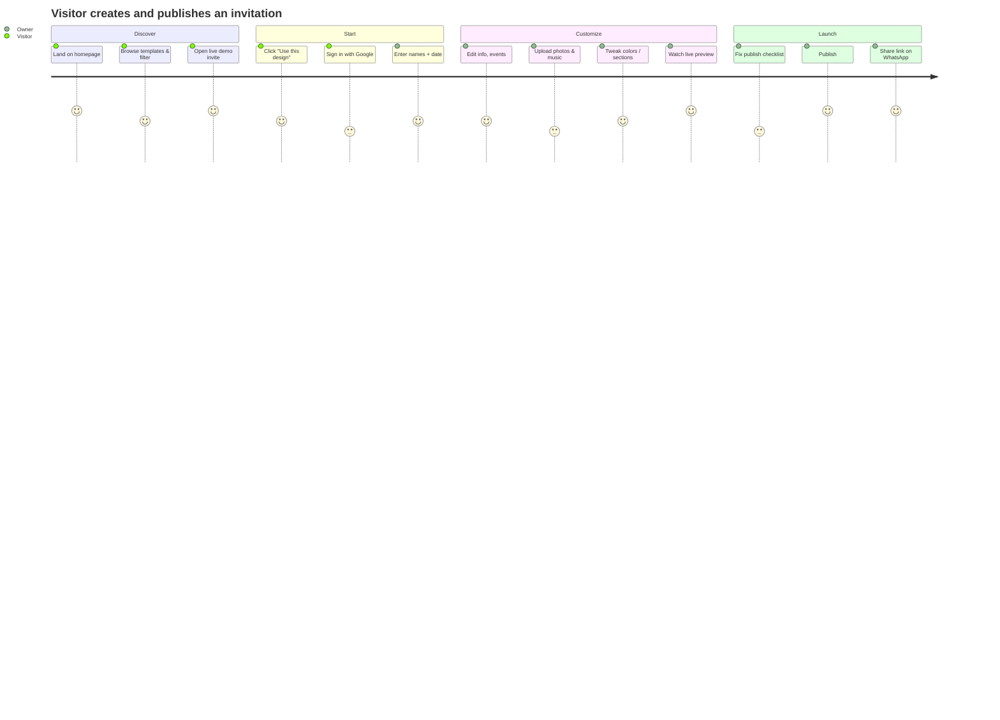
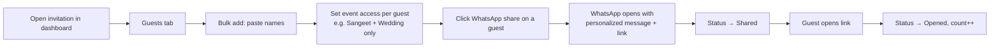
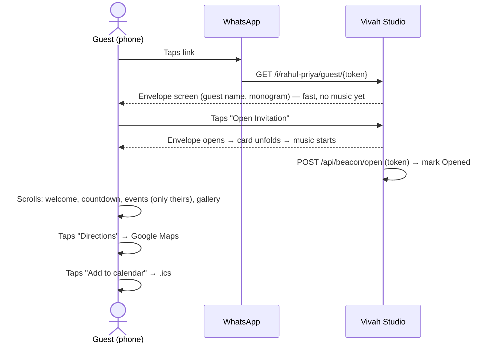

# 01 — MVP Product Requirements Document

## 1. Summary

Vivah Studio lets a couple (or a family member / planner acting for them) create a premium,
animated wedding invitation **website** in minutes: pick a designer template, fill in names,
events and photos, preview it live, publish, and share one link — or a personalized link per
guest — over WhatsApp.

The invitation opens like a real one: an envelope appears, the guest taps **Open Invitation**,
the envelope opens, the card unfolds, music starts, and a cinematic, scrollable invitation follows.

## 2. Problem & opportunity

- Printed cards are expensive, slow, and can't hold a multi-day schedule, maps, photos or music.
- Static image/PDF e-invites (the WhatsApp norm in India) look generic and don't personalize.
- Existing website builders are generic; wedding-specific ones look template-y and aren't mobile-cinematic.

**Opportunity:** a design-led, mobile-first invite that feels like a luxury product, personalized
per guest, shareable in one tap. Monetizable later per template / per invitation (₹249–₹1,499 range seen in market).

## 3. Goals (MVP)

| Goal | Measure |
|---|---|
| Owner can go from sign-up to a published invite fast | Median ≤ 15 min with demo content prefilled |
| Invitations feel premium and memorable | Qualitative review; envelope animation runs ≥ 55 fps on a mid-range Android |
| Guest experience is fast on mobile | LCP ≤ 2.5 s on 4G for invite cover; JS for invite route ≤ 180 KB gz (excl. media) |
| Personalization works and is private | Guest pages only ever contain that guest's data (verified by tests) |
| Architecture is payment-ready | Adding Razorpay later requires no change to invitation/editor code |

## 4. Non-goals / Out of scope

Explicitly **not** in the MVP (keep as future extensions):

- Payment processing, checkout, coupons, invoices
- Full RSVP management (forms, headcount, meal choice) — a guest `status` field exists for extensibility only
- Attendance tracking / check-in
- Wedding planning tools, budgets, checklists, vendor management
- AI video generation / AI copywriting
- Subscriptions or complex plans
- Native mobile apps
- Custom domains, multi-language UI (copy can be in any language the owner types)
- Team/collaborator roles on one invitation (single owner in MVP)

## 5. Personas

| Persona | Description | Needs |
|---|---|---|
| **Owner** (couple, sibling, parent, planner) | Creates and manages one or a few invitations. Mobile + laptop. Non-technical. | Beautiful result with little effort; easy editing; easy sharing; privacy |
| **Guest** | Opens a link from WhatsApp, usually on a phone, often older relatives. | Instant load, obvious "open" action, clear dates/venues/maps, readable text |
| **Visitor** | Lands on marketing site from ads/social/referral. | Be impressed quickly; see live examples; start creating |
| **Platform admin** (us) | Manages templates catalogue and abuse. | Toggle templates active, see invitation counts, takedown (MVP: via DB/seed + simple `ADMIN` role checks) |

## 6. Functional requirements

IDs are referenced from phases and tests.

### 6.1 Public site
- **FR-P1** Landing page with hero, template showcase, how-it-works, features, about, contact, footer.
- **FR-P2** Template catalogue with category filters (All / Royal / Minimal / Floral / Cinematic / Modern) and template cards with animated live previews.
- **FR-P3** Template detail page: name, description, palette, features, desktop + mobile live preview (iframe of the real renderer with demo data), CTA "Use this design".
- **FR-P4** Full-screen demo invite per template at `/templates/{slug}/preview` (same experience a guest gets, with demo data).
- **FR-P5** Contact section/form (MVP: `mailto:` + WhatsApp link; form posts to email via Resend, rate limited).

### 6.2 Accounts
- **FR-A1** Sign in with Google or email magic link. No passwords.
- **FR-A2** "Use this design" when signed out → sign in → returns to create flow with template preselected.
- **FR-A3** Sign out; delete account (soft delete + scheduled purge of media) — deletion may be a support request in MVP but data model must support it.

### 6.3 Invitations (dashboard)
- **FR-D1** Dashboard overview: counts (drafts, published, guests, opens), recent invitations, quick create.
- **FR-D2** Create invitation: choose template → enter couple names + wedding date → slug suggested → editor opens with demo content prefilled where empty.
- **FR-D3** List invitations with status filter (Draft / Published / Archived), search by title, card or table view.
- **FR-D4** Edit invitation in the editor (see 6.4). Autosave draft every change (debounced 1 s) with visible save state.
- **FR-D5** Duplicate invitation (copies draft content + design, new slug `-copy`, status Draft, **no guests copied**).
- **FR-D6** Archive (soft delete, unpublishes) and restore; permanent delete from Archived with confirmation.
- **FR-D7** Switch template on an existing invitation without losing content (content model is shared; template-specific design overrides are reset with a warning).
- **FR-D8** Publish / unpublish. Publish validates required fields. "Publish changes" when a published invite has newer draft edits.
- **FR-D9** Copy public URL, open in new tab, share to WhatsApp (`https://wa.me/?text=`), download QR code (PNG).
- **FR-D10** Custom slug editing with availability check and reserved-word rules.

### 6.4 Editor
- **FR-E1** Basic info: bride name, groom name, display order (Bride & Groom / Groom & Bride), bride's family, groom's family (parents/grandparents lines), wedding date, welcome message, invitation message, optional invocation line (e.g. "॥ श्री गणेशाय नमः ॥"), hashtag.
- **FR-E2** Events: add / edit / delete / reorder (drag). Fields: name, date, start time, end time (optional), venue name, address, Google Maps URL, description, dress code (optional), icon (from set).
- **FR-E3** Media: couple photos (1–3), family photos, gallery (up to 30 images), invitation video (1, ≤ 100 MB, or YouTube URL), background music (upload ≤ 10 MB or pick from bundled royalty-free library).
- **FR-E4** Design: color palette (template presets + custom accent/background/text), typography (template-curated font pairs), backgrounds (template presets or uploaded image), section visibility toggles, section ordering (drag), animation settings (intensity: subtle/standard/dramatic; envelope on/off; petals/particles on/off).
- **FR-E5** Live preview pane: renders the real template with draft data; device toggle (mobile 390×844 / desktop); "Replay opening" button; jumps to the section being edited.
- **FR-E6** Validation messages inline; publish checklist shows what's missing.
- **FR-E7** Media manager per invitation: upload with progress, reorder, delete, set focal point (Cloudinary `g_auto` default), alt text.

### 6.5 Guests
- **FR-G1** Guest list per invitation: add, edit, delete, bulk add (paste lines "Name" or "Name, Greeting").
- **FR-G2** Fields: display name ("Sharma Family"), salutation/greeting override, personal note (optional), event access (All events / Selected events), internal notes (owner-only).
- **FR-G3** Each guest gets a random token; link `/i/{slug}/guest/{token}`. Copy link, share to WhatsApp with prefilled personalized message, regenerate link (revokes old).
- **FR-G4** Status per guest: `Not shared` → `Shared` (owner copied/shared link) → `Opened` (first open timestamp, open count, last opened).
- **FR-G5** Guest page shows personalized welcome ("Dear Sharma Family, …"), and only events they're invited to.
- **FR-G6** Guest links only work when the invitation is published. Revoked/unknown tokens show a polite generic "This invitation link is no longer valid" page (no information leak).

### 6.6 Invitation experience (guest-facing)
- **FR-I1** Envelope intro screen with couple initials/monogram, guest name if personalized, and **Open Invitation** button.
- **FR-I2** Opening sequence (template-specific): envelope opens → card unfolds/reveals → cinematic intro → main invitation.
- **FR-I3** Music starts only after the Open tap (browser autoplay policy); floating mute/unmute control always visible.
- **FR-I4** Sections (each can be hidden/reordered by owner): Hero (names, date), Welcome/guest greeting, Couple, Families, Countdown, Events (schedule + venue + map link + add-to-calendar `.ics`), Gallery (lightbox), Video, Invitation message, Footer (hashtag, "Made with Vivah Studio" badge).
- **FR-I5** Countdown to the first event (or wedding date) in the invitation's timezone; after the date shows "Just married" state.
- **FR-I6** "Skip intro" for repeat visits (sessionStorage) and for reduced-motion users.
- **FR-I7** Open Graph image (names + date on template-styled card) for rich WhatsApp previews.

### 6.7 Platform admin (minimal)
- **FR-X1** Templates are seeded from code; `isActive` and `sortOrder` editable via seed/DB. Admin UI is out of MVP scope beyond a read-only `/admin` stats page (optional, Phase 7).
- **FR-X2** Ability to disable an invitation for abuse (`disabledAt` field), which makes all its public routes 404.

## 7. Non-functional requirements

| ID | Category | Requirement |
|---|---|---|
| NFR-1 | Performance | Invite cover LCP ≤ 2.5 s on Slow 4G/mid Android; INP ≤ 200 ms; CLS ≤ 0.05. Landing LCP ≤ 2.0 s. |
| NFR-2 | Animation | Envelope/reveal ≥ 55 fps on Pixel 6a-class device; only `transform`/`opacity`/`filter: blur` (sparingly); no layout-thrashing animations. |
| NFR-3 | Bundle | Each template is code-split; invite route ships only its template. Motion loaded via `LazyMotion`. |
| NFR-4 | Media | Images served via Cloudinary `f_auto,q_auto` with responsive widths; video lazy/poster first; audio preload `none` until open. |
| NFR-5 | Availability | Published invites served from cache (ISR); a DB outage should not take down already-cached invites. |
| NFR-6 | Security | OWASP top-10 basics, authz on every private read/write, signed uploads, CSP, rate limits. See doc 13. |
| NFR-7 | Privacy | Guest pages expose only that guest's data; invites `noindex` by default; no guest PII in URLs; tokens unguessable. |
| NFR-8 | Accessibility | WCAG 2.2 AA for dashboard and landing; invites meet contrast minimums for body text, keyboard-operable controls, `prefers-reduced-motion` honored. |
| NFR-9 | Browser support | Last 2 versions of Chrome, Safari (iOS 15+), Firefox, Edge; Samsung Internet; in-app WhatsApp/Instagram webviews. |
| NFR-10 | Maintainability | TypeScript strict; Zod schemas single source of truth; new template = new folder + registry line. |
| NFR-11 | Observability | Error tracking (Sentry), Vercel Analytics + Speed Insights, structured server logs. |
| NFR-12 | Data | Daily DB backups (Neon point-in-time restore); media retained while invitation exists; soft delete with 30-day purge. |
| NFR-13 | Localization | UI in English; invitation content supports any Unicode (Devanagari, Gurmukhi, Tamil, Urdu) with font fallbacks. Dates formatted `en-IN` by default. |

## 8. User journeys

### 8.1 Visitor → Owner → Published invite

### 8.2 Owner sends personalized links

### 8.3 Guest opens an invitation

### 8.4 Owner edits after publishing

1. Owner edits a published invitation → changes autosave to **draft** only.
2. Header shows "Unpublished changes" badge; guests still see the published snapshot.
3. Owner clicks **Publish changes** → snapshot replaced → cache revalidated → guests see new version within seconds.

### 8.5 Edge journeys

- **Slug taken** → inline suggestion (`rahul-priya-2026`, `rahul-weds-priya`).
- **Unpublish** → public URL shows a soft "This invitation is not available right now" page (HTTP 404, noindex).
- **Revoked guest token** → generic invalid-link page; owner can resend new link.
- **Template switch** → content kept; design overrides reset after confirmation.
- **Wedding date passed** → countdown section becomes "Thank you for celebrating with us"; invite remains viewable.

## 9. Success metrics (post-launch)

- Activation: % of sign-ups that publish within 7 days (target 40%).
- Share rate: avg. guest links shared per published invite.
- Open rate: % of shared guest links opened (target 70%).
- Viral loop: % of landing visits referred from an invite footer badge.

## 10. Assumptions

- Primary market is India; WhatsApp is the sharing channel; content may mix English and Indic scripts.
- One owner per invitation in MVP.
- All templates free during MVP (`tier` field exists; premium flag can be shown as "Premium — free during launch").
