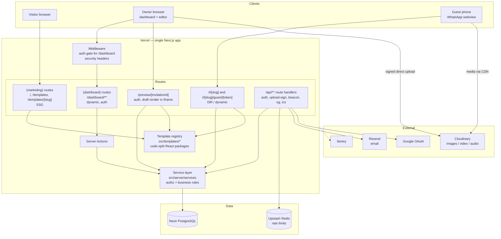
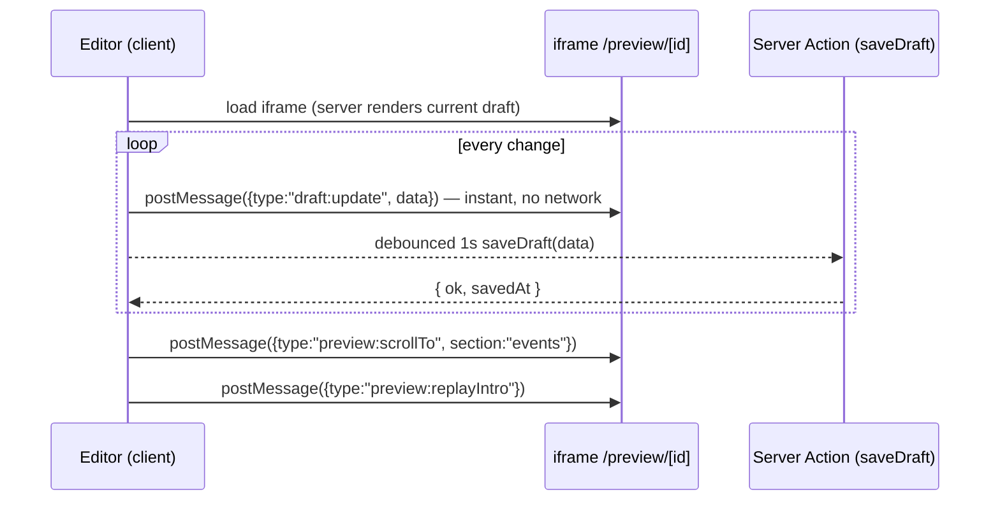

# 02 — System Architecture & Tech Stack

## 1. Stack evaluation & recommendation

| Concern | Options evaluated | Recommendation | Why |
|---|---|---|---|
| Framework | Next.js, Remix, Astro | **Next.js 15 (App Router)** | One app for marketing (SSG), dashboard (dynamic, auth), and invites (ISR). Server Components keep invite JS small; built-in `next/font`, `next/image`, `next/og`, tag revalidation. |
| UI | React 19 | **React 19** | Required by Next 15; Server Actions + `useOptimistic` for editor. |
| Language | TS / JS | **TypeScript strict** | Shared schemas across editor, renderer, DB JSON. |
| Styling | Tailwind, CSS Modules, styled-components | **Tailwind CSS v4** + CSS variables for theming | Fast to build; template theme tokens map to CSS vars so owner color changes need no rebuild. Templates may add a small CSS module for complex decorative effects. |
| Dashboard components | shadcn/ui, MUI, Mantine | **shadcn/ui (Radix)** | Owned code, accessible primitives, restyled to our luxury look. Not used inside invitation templates. |
| Animation | Motion (Framer Motion), GSAP, CSS only | **Motion (`motion/react`)** with `LazyMotion` + CSS keyframes for ambient loops | Declarative, React-native, good gesture/scroll APIs. GSAP is stronger for timelines but licensing/bundle and imperative style aren't worth it for MVP. Reassess only if a template needs complex SVG morphing. |
| Forms | react-hook-form, Formik, Conform | **react-hook-form + zodResolver** | Mature, works with field arrays (events), minimal re-renders. |
| Drag & drop | dnd-kit, react-beautiful-dnd | **dnd-kit** | Events, sections and gallery ordering; accessible, maintained. |
| Backend runtime | Separate Node/Express API, Next.js route handlers + server actions | **Node.js via Next.js (Node runtime)** | One deployable, shared TypeScript types, no CORS/session plumbing. Business logic lives in a plain service layer (`src/server/services`) with no Next.js imports, so it can move to an Express/Fastify service later if a mobile app or heavy jobs need it. |
| Database | PostgreSQL, MySQL, MongoDB | **PostgreSQL (Neon)** | Relational integrity for users → invitations → guests → (future) orders/payments, plus JSONB for the nested invitation content and its draft/published snapshots — the best of both. Neon: serverless Postgres, branch per preview deploy, point-in-time restore, Vercel integration. |
| ORM | Prisma, Drizzle | **Prisma 6** | Typed client, declarative schema, reliable migrations, Auth.js adapter. JSONB columns are typed `Json` and parsed with Zod on read. Use the Neon serverless driver adapter (`@prisma/adapter-neon`) for connection pooling on Vercel. |
| Auth | Auth.js, Clerk | **Auth.js v5** (Google + Resend magic link, Prisma adapter, DB sessions) | Free, data in our DB (needed for ownership + future orders), no per-MAU cost. Clerk is faster to set up and has nicer UI but adds vendor cost/lock-in and user data outside our DB. |
| Media | Cloudinary, S3 (+ CloudFront + Lambda) | **Cloudinary** | On-the-fly resize/format (`f_auto,q_auto`), video transcoding + posters, signed direct uploads, focal-point cropping. S3 is cheaper at scale but needs us to build transforms. Abstract behind `MediaStorage` interface to allow S3 later. |
| Email | Resend, SES, Postmark | **Resend** | Magic links + contact form; simple API, React email templates. |
| Hosting | Vercel, Netlify, self-host | **Vercel** | First-class Next.js ISR, edge middleware, preview deploys, OG image generation. |
| Monitoring | Sentry, Vercel Analytics | **Sentry + Vercel Analytics/Speed Insights** | Errors + Core Web Vitals per route. |
| Testing | Vitest, Playwright | **Vitest** (units, schemas, services) + **Playwright** (critical flows, privacy checks) | |
| Rate limiting | Upstash, in-DB | **Upstash Redis ratelimit** | Beacon, contact form, slug check, magic links. |
| QR code | `qrcode` | **qrcode** | Client-side PNG generation. |

### Approved libraries

`next`, `react`, `react-dom`, `typescript`, `tailwindcss`, `motion`, `prisma`, `@prisma/client`, `@prisma/adapter-neon`, `@neondatabase/serverless`,
`next-auth@5`, `@auth/prisma-adapter`, `zod`, `react-hook-form`, `@hookform/resolvers`,
`@dnd-kit/core`, `@dnd-kit/sortable`, shadcn/ui deps (`@radix-ui/*`, `class-variance-authority`,
`clsx`, `tailwind-merge`, `lucide-react`), `cloudinary` (server), `next-cloudinary` (optional),
`resend`, `@upstash/ratelimit`, `@upstash/redis`, `qrcode`, `date-fns`, `date-fns-tz`, `nanoid`
(not for tokens — tokens use `crypto.randomBytes`), `sonner` (toasts), `yet-another-react-lightbox`,
`@sentry/nextjs`, `@vercel/analytics` (page views; URLs scrubbed by `src/lib/analytics.ts`), `vitest`, `@testing-library/react`, `@playwright/test`.

Anything else: ask first.

## 2. System architecture

### Layers

1. **Routes (App Router)** — thin. Server Components fetch via services; client components only where interactivity is needed.
2. **Server Actions** (`src/app/(dashboard)/**/actions.ts`) — parse input with Zod → call service → `revalidatePath`/`revalidateTag` → return typed result `{ ok: true, data } | { ok: false, error }`.
3. **Services** (`src/server/services/*.ts`) — all business rules and authorization. The only code that imports the Prisma client. Every function takes a `ctx: { userId }` (or is explicitly public, e.g. `getPublishedInvitationBySlug`).
4. **Template engine** (`src/templates/*`, `src/invitation-kit/*`) — pure rendering from `RenderableInvitation` data. No DB access, no auth logic.
5. **Integrations** (`src/server/integrations/*`) — Cloudinary, Resend, rate limiter. Behind small interfaces for swapability (S3 later, payment gateways later).

## 3. Rendering strategy per route

| Route | Rendering | Data source | Cache |
|---|---|---|---|
| `/`, `/templates`, `/templates/[slug]`, `/about` | Static (SSG) | Template registry + `Template` table | Build time; revalidate on template change |
| `/templates/[slug]/preview` | Static | Template demo data | Build time |
| `/dashboard/**` | Dynamic | Services (owner-scoped) | `no-store` |
| `/preview/[invitationId]` | Dynamic, client-updated | Draft from service, then live updates via `postMessage` from editor | `no-store` |
| `/i/[slug]` | ISR (`revalidate: false`, on-demand via tag `invitation:{id}`) | `published` snapshot | Vercel data cache; purged on publish/unpublish/disable |
| `/i/[slug]/guest/[token]` | Dynamic (per token) | `published` snapshot (cached by tag) + guest row | Invitation snapshot cached; guest lookup uncached; `Cache-Control: private, no-store` |
| `/api/og/[slug]` | Edge/Node `ImageResponse` | published snapshot | Cached by CDN, purged with tag |

## 4. Live preview architecture

- The iframe gives a real mobile viewport (media queries, `vh` units) and isolates template fonts/CSS from the dashboard.
- `postMessage` uses a strict origin check and a typed message union (`src/lib/preview/messages.ts`).
- The same `<InvitationRenderer>` component is used by the preview, the public invite and the template demo — one code path.

## 5. Deployment architecture

See [14-deployment.md](14-deployment.md).
