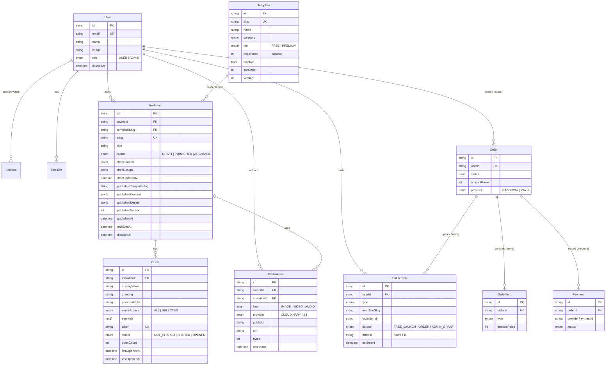

# 03 — Database (PostgreSQL + Prisma)

## 1. Modelling approach

- **Relational for ownership and things that grow; JSONB for the invitation document.**
  - Users, invitations, guests, media assets, entitlements (and later orders/payments) are tables with FKs.
  - An invitation's content (couple, families, events, media references, messages) and design
    (palette, fonts, sections, animation) are always read and written together → **JSONB** columns.
- **Draft vs published snapshots.** The editor writes only `draftContent` / `draftDesign`.
  Publishing copies them into `publishedContent` / `publishedDesign` / `publishedTemplateSlug`
  (+ `publishedAt`, `publishedVersion++`). Public routes read **only** the published columns.
- **Events live inside content JSON with stable string ids** (`evt_` + 10-char nanoid). Guests reference
  them via `Guest.eventIds text[]`. This keeps snapshots self-contained (a published snapshot never
  points at rows that were edited later). Trade-off discussed in [16-risks-and-tradeoffs.md](16-risks-and-tradeoffs.md).
- **Zod owns the JSON shape** (`src/lib/invitation/schema.ts`, see [05-template-engine.md](05-template-engine.md)).
  Every JSONB read that feeds a template is parsed by Zod, which also applies defaults.
- **`contentSchemaVersion`** enables lazy JSON migrations (`migrateContent(v1 → v2)` on read, rewritten on next save).
- **IDs:** `cuid()` everywhere. Public URLs never contain ids — only slugs and guest tokens.

## 2. ER diagram



`Order`, `OrderItem` and `Payment` are **designed, not migrated** in the MVP — see [17-future-payments.md](17-future-payments.md).

## 3. Prisma schema (MVP)

```prisma
// prisma/schema.prisma
generator client {
  provider        = "prisma-client-js"
  previewFeatures = ["driverAdapters"]
}

datasource db {
  provider  = "postgresql"
  url       = env("DATABASE_URL")          // pooled
  directUrl = env("DATABASE_URL_UNPOOLED") // migrations
}

// ───────────── Auth.js ─────────────
model User {
  id            String    @id @default(cuid())
  email         String    @unique
  emailVerified DateTime?
  name          String?
  image         String?
  role          Role      @default(USER)
  deletedAt     DateTime?
  createdAt     DateTime  @default(now())
  updatedAt     DateTime  @updatedAt

  accounts      Account[]
  sessions      Session[]
  invitations   Invitation[]
  mediaAssets   MediaAsset[]
  entitlements  Entitlement[]
}

enum Role { USER ADMIN }

model Account {
  id                String  @id @default(cuid())
  userId            String
  type              String
  provider          String
  providerAccountId String
  refresh_token     String? @db.Text
  access_token      String? @db.Text
  expires_at        Int?
  token_type        String?
  scope             String?
  id_token          String? @db.Text
  session_state     String?
  user              User    @relation(fields: [userId], references: [id], onDelete: Cascade)

  @@unique([provider, providerAccountId])
}

model Session {
  id           String   @id @default(cuid())
  sessionToken String   @unique
  userId       String
  expires      DateTime
  user         User     @relation(fields: [userId], references: [id], onDelete: Cascade)
}

model VerificationToken {
  identifier String
  token      String   @unique
  expires    DateTime

  @@unique([identifier, token])
}

// ───────────── Catalogue ─────────────
model Template {
  id          String           @id @default(cuid())
  slug        String           @unique              // matches src/templates/<slug>
  name        String
  tagline     String?
  category    TemplateCategory
  tags        String[]
  tier        TemplateTier     @default(FREE)
  pricePaise  Int?                                  // future
  isActive    Boolean          @default(true)
  isNew       Boolean          @default(false)
  sortOrder   Int              @default(0)
  version     Int              @default(1)
  posterUrl   String?                               // static poster for SEO/OG
  createdAt   DateTime         @default(now())
  updatedAt   DateTime         @updatedAt

  invitations Invitation[]

  @@index([isActive, sortOrder])
}

enum TemplateCategory { ROYAL MINIMAL FLORAL CINEMATIC MODERN }
enum TemplateTier     { FREE PREMIUM }

// ───────────── Invitations ─────────────
model Invitation {
  id                    String           @id @default(cuid())
  ownerId               String
  templateSlug          String                                  // current (draft) template
  slug                  String           @unique
  title                 String           @db.VarChar(120)
  status                InvitationStatus @default(DRAFT)

  contentSchemaVersion  Int              @default(1)
  draftContent          Json                                    // InvitationContent (Zod)
  draftDesign           Json                                    // DesignConfig (Zod)
  draftUpdatedAt        DateTime         @default(now())

  publishedTemplateSlug String?
  publishedContent      Json?
  publishedDesign       Json?
  publishedVersion      Int              @default(0)
  publishedAt           DateTime?
  unpublishedAt         DateTime?

  archivedAt            DateTime?
  disabledAt            DateTime?                               // platform takedown
  disabledReason        String?

  weddingDate           DateTime?        @db.Date               // denormalized for list/sort
  coverImageUrl         String?                                 // denormalized for list cards
  openCount             Int              @default(0)

  createdAt             DateTime         @default(now())
  updatedAt             DateTime         @updatedAt

  owner                 User             @relation(fields: [ownerId], references: [id], onDelete: Cascade)
  template              Template         @relation(fields: [templateSlug], references: [slug])
  guests                Guest[]
  mediaAssets           MediaAsset[]

  @@index([ownerId, status, updatedAt(sort: Desc)])
  @@index([slug, status])
}

enum InvitationStatus { DRAFT PUBLISHED ARCHIVED }

// ───────────── Guests ─────────────
model Guest {
  id             String           @id @default(cuid())
  invitationId   String
  displayName    String           @db.VarChar(80)    // "Sharma Family"
  greeting       String?          @db.VarChar(120)   // "Dear Sharma ji and family"
  personalNote   String?          @db.VarChar(500)   // rendered on their page
  notes          String?          @db.VarChar(500)   // owner-only, NEVER rendered
  phone          String?          @db.VarChar(20)    // owner-only, for wa.me deep link
  eventAccess    EventAccess      @default(ALL)
  eventIds       String[]                            // content.events[].id

  token          String           @unique            // 22-char base64url, 128-bit random
  tokenCreatedAt DateTime         @default(now())

  status         GuestStatus      @default(NOT_SHARED)
  sharedAt       DateTime?
  firstOpenedAt  DateTime?
  lastOpenedAt   DateTime?
  openCount      Int              @default(0)

  rsvp           Json?                               // RESERVED for future RSVP; unused in MVP

  createdAt      DateTime         @default(now())
  updatedAt      DateTime         @updatedAt

  invitation     Invitation       @relation(fields: [invitationId], references: [id], onDelete: Cascade)
  revokedTokens  RevokedGuestToken[]

  @@index([invitationId, createdAt(sort: Desc)])
}

enum EventAccess { ALL SELECTED }
enum GuestStatus { NOT_SHARED SHARED OPENED }

/// Old tokens after "Regenerate link" — lets us show "this link was replaced" without leaking anything.
model RevokedGuestToken {
  token     String   @id
  guestId   String
  revokedAt DateTime @default(now())
  guest     Guest    @relation(fields: [guestId], references: [id], onDelete: Cascade)
}

// ───────────── Media ─────────────
model MediaAsset {
  id           String        @id @default(cuid())
  ownerId      String
  invitationId String?
  kind         MediaKind
  role         MediaRole?
  provider     MediaProvider @default(CLOUDINARY)
  publicId     String                                  // invitoverse/{userId}/{invitationId}/{nanoid}
  url          String                                  // original secure URL
  mimeType     String?
  bytes        Int?
  width        Int?
  height       Int?
  durationSec  Float?
  alt          String?       @db.VarChar(200)
  focalX       Float?                                  // 0..1
  focalY       Float?
  deletedAt    DateTime?
  createdAt    DateTime      @default(now())

  owner        User          @relation(fields: [ownerId], references: [id], onDelete: Cascade)
  invitation   Invitation?   @relation(fields: [invitationId], references: [id], onDelete: SetNull)

  @@unique([provider, publicId])
  @@index([invitationId])
  @@index([ownerId])
}

enum MediaKind     { IMAGE VIDEO AUDIO }
enum MediaRole     { COUPLE FAMILY GALLERY BACKGROUND VIDEO MUSIC OTHER }
enum MediaProvider { CLOUDINARY S3 }

// ───────────── Payment-ready seam (used in MVP) ─────────────
model Entitlement {
  id           String            @id @default(cuid())
  userId       String
  type         EntitlementType
  templateSlug String?
  invitationId String?
  feature      String?                                 // "REMOVE_BADGE" | "VIDEO" | ...
  source       EntitlementSource
  orderId      String?                                 // FK added when Order exists
  expiresAt    DateTime?
  createdAt    DateTime          @default(now())

  user         User              @relation(fields: [userId], references: [id], onDelete: Cascade)

  @@index([userId, type])
}

enum EntitlementType   { TEMPLATE INVITATION_PUBLISH FEATURE }
enum EntitlementSource { FREE_LAUNCH ORDER ADMIN_GRANT }
```

### Notes

- **Slug rules:** `^[a-z0-9](?:[a-z0-9-]{1,46}[a-z0-9])$` (3–48 chars), unique, not in `RESERVED_SLUGS`
  (`admin, api, app, dashboard, i, login, preview, templates, static, www, …`). Slug changes after
  publish are allowed with a warning that old links break (MVP: no redirects; future: `SlugHistory`).
- **`hasUnpublishedChanges`** is computed: `status = PUBLISHED && draftUpdatedAt > publishedAt`.
- **`weddingDate` / `coverImageUrl`** are denormalized from draft content on every save so the
  dashboard list never loads JSONB.
- **Limits (MVP):** 1,000 guests per invitation; 60 images, 1 video (100 MB), 1 audio (10 MB), 300 MB total per invitation.
- **In MVP no Entitlement rows are required:** `canUseTemplate()` returns `true` for FREE templates and
  for PREMIUM while `LAUNCH_ALL_FREE=true`. All gates call it so payments slot in without editor changes.

## 4. Example row (JSONB abbreviated)

```json
{
  "id": "clx9r2k0d0001qz8h3f4a5b6c",
  "ownerId": "clx9qz1aa0000qz8hu1v2w3x4",
  "templateSlug": "royal-heritage",
  "slug": "rahul-priya",
  "title": "Rahul & Priya Wedding",
  "status": "PUBLISHED",
  "contentSchemaVersion": 1,
  "draftContent":   { "couple": { "...": "..." }, "events": [ "..." ] },
  "draftDesign":    { "palette": { "...": "..." }, "sections": [ "..." ] },
  "draftUpdatedAt": "2026-11-18T10:21:00.000Z",
  "publishedTemplateSlug": "royal-heritage",
  "publishedContent": { "...": "..." },
  "publishedDesign":  { "...": "..." },
  "publishedVersion": 3,
  "publishedAt": "2026-11-18T10:20:00.000Z",
  "weddingDate": "2027-02-14",
  "openCount": 311
}
```

Full content/design JSON: [05-template-engine.md §4](05-template-engine.md).

## 5. Transactions & consistency

| Operation | How |
|---|---|
| Save draft | Single `updateMany` with `where: { id, ownerId, draftUpdatedAt }` → ownership + optimistic lock in one statement |
| Publish | Single `update` copying draft → published columns, `publishedVersion: { increment: 1 }` |
| Duplicate | `$transaction`: read source (owned) → insert copy (no guests) |
| Regenerate guest token | `$transaction`: insert `RevokedGuestToken(old)` → update guest with new token |
| Delete permanently | Delete invitation (guests + revoked tokens cascade); `MediaAsset.invitationId` set null + `deletedAt` set; Cloudinary purge by cron |
| Guest open beacon | `update` guest (`openCount: { increment: 1 }`, timestamps, status) + `update` invitation `openCount` — no transaction needed |
| Event deleted from content | On publish, `UPDATE "Guest" SET "eventIds" = array_remove(...)` for ids no longer present (raw SQL via `$executeRaw`) |

## 6. Connection handling on Vercel

```ts
// src/server/db/prisma.ts
import "server-only";
import { PrismaClient } from "@prisma/client";
import { PrismaNeon } from "@prisma/adapter-neon";
import { Pool } from "@neondatabase/serverless";

const g = globalThis as unknown as { prisma?: PrismaClient };
export const prisma =
  g.prisma ??
  new PrismaClient({ adapter: new PrismaNeon(new Pool({ connectionString: process.env.DATABASE_URL })) });
if (process.env.NODE_ENV !== "production") g.prisma = prisma;
```

Migrations run with `prisma migrate deploy` against `DATABASE_URL_UNPOOLED` in the deploy step.

## 7. Data lifecycle

- **Archive** → `status ARCHIVED`, `archivedAt`; published columns kept but public routes 404; restorable.
- **Permanent delete** (only from Archived) → row deleted, cascades; media purged by nightly cron (`/api/cron/media-cleanup`).
- **Account delete** → `User.deletedAt`, all invitations archived + disabled; hard purge after 30 days.
- **Backups** → Neon point-in-time restore (7 days on free/launch, longer on paid); restore drill before launch.

## 8. Seed data

`prisma/seed.ts`:
1. Upsert the 5 templates from `src/templates/registry.ts` manifests.
2. Dev only: create `demo@invitoverse.local` with a published "Rahul & Priya" invitation (`/i/rahul-priya`) and
   3 guests — Rahul Sharma (ALL), Amit Verma (ALL), Sharma Family (SELECTED: Sangeet + Wedding) — for local testing.
