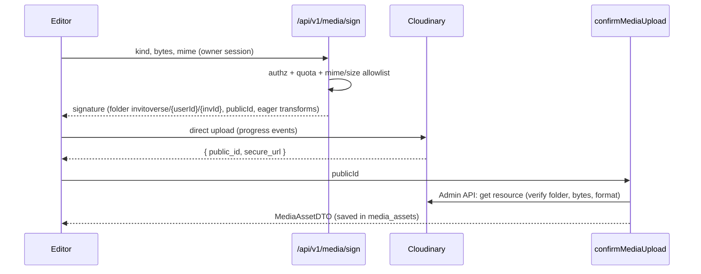

# 04 — API Design

## 1. Principles

- **Two transports, one service layer.**
  - Dashboard mutations → **Server Actions** (type-safe, no client fetch boilerplate, CSRF-protected by Next.js origin checks).
  - Things that must be plain HTTP → **Route Handlers** under `src/app/api/**` (Auth.js, upload signing, open beacon, `.ics`, OG images, cron, health).
  - Both call `src/server/services/*`. Services never import Next.js APIs, so a separate Node/Express
    API (e.g. for a future mobile app) can reuse them unchanged.
- **Every input is parsed with Zod** in the action/handler before reaching a service.
- **Uniform result type** for actions:

```ts
type ActionResult<T> =
  | { ok: true; data: T }
  | { ok: false; error: { code: ErrorCode; message: string; fieldErrors?: Record<string, string[]> } };

type ErrorCode =
  | "UNAUTHENTICATED" | "FORBIDDEN" | "NOT_FOUND" | "VALIDATION"
  | "CONFLICT"        // slug taken, stale version
  | "LIMIT_EXCEEDED"  // quota
  | "RATE_LIMITED" | "ENTITLEMENT_REQUIRED" | "INTERNAL";
```

- **Ownership**: services load resources with `{ _id, ownerId: ctx.userId }`. A miss returns
  `NOT_FOUND` (never `FORBIDDEN`) so ids can't be probed.
- **Optimistic concurrency** on draft saves: client sends `draftUpdatedAt` it last saw; service
  updates with that as a filter; mismatch → `CONFLICT` ("This invitation was changed in another tab").

## 2. Logical API (service operations)

The table is the contract. "Transport" says how the UI reaches it.

### 2.1 Templates (public)

| Operation | Transport | Input | Output |
|---|---|---|---|
| List active templates | RSC (direct service call) | `{ category? }` | `TemplateCard[]` |
| Get template detail | RSC | `slug` | `TemplateDetail` (manifest + catalogue fields) |
| `GET /api/v1/templates` | Route handler (public, cached) | `?category=` | `TemplateCard[]` — for future clients |

### 2.2 Invitations (owner)

| Operation | Server Action | Input (Zod) | Output | Notes |
|---|---|---|---|---|
| Create | `createInvitation` | `{ templateSlug, brideName, groomName, weddingDate, slug? }` | `{ id, slug }` | Checks `canUseTemplate`. Prefills content from template demo for empty optional fields (clearly marked as sample). |
| List | RSC `listInvitations` | `{ status?, q?, page? }` | `InvitationListItem[]` | `select` excludes the JSONB bodies. |
| Get for editor | RSC `getInvitationForEditor` | `id` | `{ meta, draft, templateManifest, hasUnpublishedChanges }` | |
| Save draft | `saveDraft` | `{ id, draftUpdatedAt, content?, design? }` | `{ draftUpdatedAt }` | Partial: either part may be sent. Full Zod validation in "lenient" mode (drafts may be incomplete). |
| Rename | `updateInvitationMeta` | `{ id, title }` | `{}` | |
| Check slug | `checkSlug` | `{ slug, excludeId? }` | `{ available, suggestions[] }` | Rate limited 30/min/user. |
| Change slug | `changeSlug` | `{ id, slug }` | `{ slug }` | Revalidates old + new tags. |
| Switch template | `switchTemplate` | `{ id, templateSlug, keepDesign: false }` | `{}` | Resets `design.templateOptions` + theme overrides. |
| Duplicate | `duplicateInvitation` | `{ id }` | `{ id, slug }` | No guests copied. |
| Publish | `publishInvitation` | `{ id }` | `{ publishedVersion, url }` | Strict validation (publish checklist). See doc 06. |
| Unpublish | `unpublishInvitation` | `{ id }` | `{}` | |
| Archive / Restore | `archiveInvitation` / `restoreInvitation` | `{ id }` | `{}` | Archive also unpublishes. |
| Delete permanently | `deleteInvitation` | `{ id, confirmSlug }` | `{}` | Only from ARCHIVED; user must type slug. Cascades guests; media marked for cleanup. |
| Get publish checklist | RSC / `getPublishChecklist` | `id` | `ChecklistItem[]` | |

### 2.3 Guests (owner)

| Operation | Server Action | Input | Output |
|---|---|---|---|
| List | RSC `listGuests` | `{ invitationId, q?, status? }` | `GuestRow[]` (includes link) |
| Add | `addGuest` | `{ invitationId, displayName, greeting?, personalNote?, notes?, phone?, eventAccess, eventIds[] }` | `GuestRow` |
| Bulk add | `bulkAddGuests` | `{ invitationId, lines: string }` (≤ 500 lines) | `{ created: n, skipped: [{line, reason}] }` |
| Update | `updateGuest` | `{ id, ...fields }` | `GuestRow` |
| Delete | `deleteGuest` | `{ id }` | `{}` |
| Regenerate link | `regenerateGuestToken` | `{ id }` | `{ url }` |
| Mark shared | `markGuestShared` | `{ id }` | `{}` — called when owner clicks Copy/WhatsApp |
| Export CSV | Route handler `GET /api/v1/invitations/{id}/guests.csv` | — | CSV (name, link, status, opens) | Auth + ownership. |

`eventIds` are validated against the invitation's **draft** event ids; when events are deleted,
the service strips dangling ids from guests on the next publish.

### 2.4 Media (owner)

| Operation | Transport | Input | Output |
|---|---|---|---|
| Sign upload | `POST /api/v1/media/sign` | `{ invitationId, kind, role, bytes, mimeType }` | `{ cloudName, apiKey, timestamp, signature, folder, publicId, uploadPreset? , resourceType }` |
| Confirm upload | `confirmMediaUpload` (action) | `{ invitationId, publicId, resourceType }` | `MediaAssetDTO` — server fetches resource from Cloudinary Admin API to trust size/dimensions (never trusts client metadata) |
| Update meta | `updateMedia` | `{ id, alt?, focalPoint? }` | `MediaAssetDTO` |
| Delete | `deleteMedia` | `{ id }` | `{}` — removes from draft content references too |
| List | RSC `listMedia` | `{ invitationId, kind? }` | `MediaAssetDTO[]` |

Upload flow:



### 2.5 Public invitation (guest-facing)

| Route | Method | Purpose | Auth | Notes |
|---|---|---|---|---|
| `/i/{slug}` | GET (page) | Public invitation | none | Only `status=PUBLISHED`, not disabled. 404 otherwise. |
| `/i/{slug}/guest/{token}` | GET (page) | Personalized invitation | token | Token must belong to that invitation and not be revoked. |
| `/api/v1/beacon/open` | POST | Record an open after the guest taps "Open" | none | Body `{ slug, token? }`; rate limited 20/min/IP; idempotent per session via `sessionStorage` flag; `sendBeacon`. Returns 204 always (no oracle). |
| `/api/v1/ics/{slug}/{eventId}` | GET | Add-to-calendar file | none (or `?t=token`) | If event is guest-restricted, requires token with access. |
| `/api/og/{slug}` | GET | OG image 1200×630 | none | Uses published snapshot; generic image for guest routes (no guest names in OG). |

### 2.6 Account & misc

| Route / Action | Purpose |
|---|---|
| `/api/auth/[...nextauth]` | Auth.js (Google, Resend email) |
| `deleteAccount` (action) | Soft delete + archive all invitations |
| `POST /api/v1/contact` | Landing contact form → Resend email; Zod + honeypot + rate limit 5/hour/IP |
| `GET /api/health` | Liveness: app + `SELECT 1` DB ping |
| `GET /api/cron/media-cleanup` | Vercel Cron, `Authorization: Bearer CRON_SECRET` |

## 3. DTOs (excerpt)

```ts
type InvitationListItem = {
  id: string; slug: string; title: string;
  templateSlug: string; templateName: string;
  status: "DRAFT" | "PUBLISHED" | "ARCHIVED";
  hasUnpublishedChanges: boolean;
  weddingDate: string | null;     // ISO date
  coverImageUrl: string | null;
  guestCount: number; openCount: number;
  updatedAt: string; publishedAt: string | null;
  publicUrl: string | null;       // only when published
};

type GuestRow = {
  id: string; displayName: string; greeting?: string;
  eventAccess: "ALL" | "SELECTED"; eventIds: string[];
  status: "NOT_SHARED" | "SHARED" | "OPENED";
  openCount: number; firstOpenedAt?: string; lastOpenedAt?: string;
  url: string;                     // https://invitationbanao.com/i/rahul-priya/guest/Xk3...
  whatsappUrl: string;             // https://wa.me/?text=... (or wa.me/<phone>?text=...)
};

type ChecklistItem = { key: string; label: string; ok: boolean; severity: "required" | "recommended"; fixHref: string };
```

## 4. Example: `saveDraft` action

```ts
// src/app/(dashboard)/dashboard/invitations/[id]/edit/actions.ts
"use server";
export async function saveDraft(input: unknown): Promise<ActionResult<{ draftUpdatedAt: string }>> {
  const user = await requireUser();                         // throws → UNAUTHENTICATED
  const parsed = SaveDraftInput.safeParse(input);
  if (!parsed.success) return validationError(parsed.error);
  return invitationService.saveDraft({ userId: user.id }, parsed.data);
}
```

```ts
// src/server/services/invitations.ts (excerpt)
export async function saveDraft(ctx: Ctx, input: SaveDraftInput) {
  const data: Prisma.InvitationUpdateManyMutationInput = { draftUpdatedAt: new Date() };
  if (input.content) data.draftContent = DraftContentSchema.parse(input.content);
  if (input.design)  data.draftDesign  = DesignConfigSchema.parse(input.design);
  // ownership + optimistic concurrency in one statement
  const res = await prisma.invitation.updateMany({
    where: { id: input.id, ownerId: ctx.userId, draftUpdatedAt: new Date(input.draftUpdatedAt) },
    data,
  });
  if (res.count === 0) {
    const exists = await prisma.invitation.count({ where: { id: input.id, ownerId: ctx.userId } });
    return err(exists ? "CONFLICT" : "NOT_FOUND");
  }
  const now = data.draftUpdatedAt as Date;
  return ok({ draftUpdatedAt: now.toISOString() });
}
```

## 5. Rate limits (Upstash)

| Key | Limit |
|---|---|
| Magic-link email per email/IP | 5 / 15 min |
| `checkSlug` per user | 30 / min |
| Media sign per user | 60 / hour |
| Beacon per IP | 20 / min |
| Contact form per IP | 5 / hour |
| Guest page per IP (middleware, coarse) | 120 / min — blunts token brute force |
| Invalid guest token per IP | 10 / 10 min → then serve invalid page without DB lookup |
