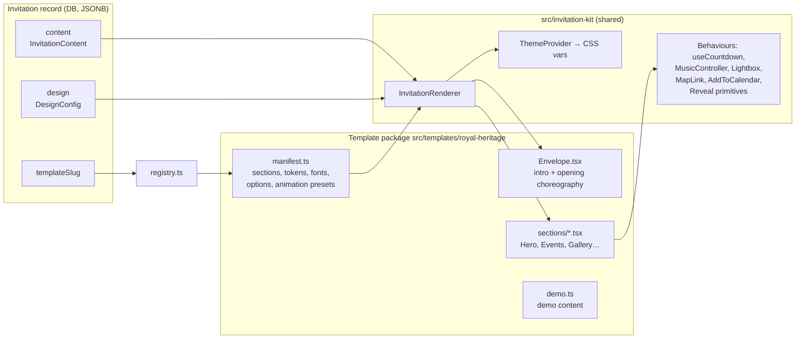

# 05 — Template Engine Architecture

## 1. Options evaluated

| Approach | How it works | Pros | Cons |
|---|---|---|---|
| **A. Pure JSON-driven** (page-builder) | Template = JSON tree of generic blocks (`{type:"text", style:{…}}`), one generic renderer | Templates editable without deploys; could build a visual template builder | Generic blocks can't deliver bespoke envelope/reveal choreography; ends up re-inventing CSS in JSON; premium feel suffers |
| **B. Pure code components** | Each template is a hand-built React page reading invitation data | Maximum design freedom | Customization options drift per template; editor needs per-template knowledge; duplicated logic (countdown, maps, gallery) |
| **C. Hybrid (chosen)** | Templates are **code packages** with a **declarative manifest** (sections, theme tokens, fonts, options schema). Invitation is **JSON data** (shared content model + design overrides). A shared **invitation kit** provides behaviour (countdown, events, gallery, music); templates provide look and motion. | Bespoke premium design per template *and* one editor/data model; new template = new folder; editor UI generated from manifest | Template changes need a deploy (acceptable: we design templates in-house for MVP) |

**Decision: C — hybrid.** Content is data; design is code + tokens; customization surface is declared by the manifest.

## 2. Concepts



| Concept | Owned by | Description |
|---|---|---|
| **InvitationContent** | Shared Zod schema | What the invitation *says*: names, families, events, media refs, messages. Identical for every template. |
| **DesignConfig** | Shared Zod schema + manifest-declared options | How the owner *customized* it: palette, font pair, background, section order/visibility, animation settings, template-specific options. |
| **TemplateManifest** | Template package | What the template *supports*: sections, default tokens, palette presets, font pairs, backgrounds, animation presets, option schema. |
| **Template components** | Template package | Envelope + section components implementing the look and motion. |
| **Invitation kit** | Shared | Renderer, theme → CSS variables, behaviours and accessible primitives used by all templates. |
| **RenderableInvitation** | Computed | `resolve(content, design, manifest, guest?)` — merged, defaulted, guest-filtered data passed to components. |

## 3. Section model

Common section keys (the vocabulary every template maps to):

| Key | Purpose | Data used |
|---|---|---|
| `hero` | Names, date, invocation, monogram | `couple`, `weddingDate`, `invocation` |
| `greeting` | Personalized welcome (guest) or generic welcome | `messages.welcome`, `guest` |
| `couple` | Bride & groom photos + short bios | `couple`, `media.couplePhotos` |
| `families` | Parents / families lines ("With the blessings of…") | `families` |
| `countdown` | Days/hours/min/sec to the wedding date | `weddingDate` (+ that day's first event time) |
| `events` | Schedule with venue, map, add-to-calendar | `events` (guest-filtered) |
| `gallery` | Photo grid + lightbox | `media.gallery`, `media.familyPhotos` |
| `video` | Invitation/pre-wedding video | `media.video` |
| `message` | Long invitation message / poem / note | `messages.invitation` |
| `footer` | Hashtag, thank-you, badge | `hashtag`, `messages.closing` |

A template **must** implement `hero`, `events`, `footer`; it **may** implement any others (manifest
declares which). Unknown/unsupported sections in a design config are ignored by the renderer.

## 4. JSON structures

### 4.1 InvitationContent (shared — `draftContent` / `publishedContent`)

```json
{
  "schemaVersion": 1,
  "couple": {
    "order": "BRIDE_FIRST",
    "bride": { "firstName": "Priya", "lastName": "Malhotra", "shortBio": "Architect, chai enthusiast, eternal optimist." },
    "groom": { "firstName": "Rahul", "lastName": "Sharma", "shortBio": "Product designer who still can't dance." },
    "monogram": "PR"
  },
  "families": {
    "bride": { "label": "Daughter of", "lines": ["Mrs. Neelam & Mr. Rajesh Malhotra"], "grandparents": ["Late Smt. Kamla Devi & Shri Om Prakash Malhotra"] },
    "groom": { "label": "Son of", "lines": ["Mrs. Sunita & Mr. Anil Sharma"], "grandparents": [] }
  },
  "invocation": "॥ श्री गणेशाय नमः ॥",
  "weddingDate": "2027-02-14",
  "timezone": "Asia/Kolkata",
  "city": "New Delhi",
  "hashtag": "#RaPriyaForever",
  "messages": {
    "welcome": "Together with our families, we joyfully invite you to celebrate our wedding.",
    "invitation": "Two souls, two families, one beautiful journey. Your presence and blessings will make our celebration complete.",
    "closing": "With love, Priya & Rahul"
  },
  "events": [
    {
      "id": "evt_h3k9w2m1qa",
      "name": "Haldi",
      "icon": "haldi",
      "date": "2027-02-12",
      "startTime": "10:00",
      "endTime": "13:00",
      "venue": { "name": "Malhotra Residence", "address": "B-14, Vasant Vihar, New Delhi 110057", "mapsUrl": "https://maps.app.goo.gl/xxxxxxxx" },
      "description": "A morning of turmeric, laughter and marigolds.",
      "dressCode": "Shades of yellow"
    },
    {
      "id": "evt_s8d2n4p0zt",
      "name": "Sangeet",
      "icon": "music",
      "date": "2027-02-13",
      "startTime": "19:00",
      "venue": { "name": "The Grand Ballroom, Taj Palace", "address": "2 Sardar Patel Marg, New Delhi 110021", "mapsUrl": "https://maps.app.goo.gl/yyyyyyyy" },
      "description": "An evening of music, dance and family performances.",
      "dressCode": "Indo-western glam"
    },
    {
      "id": "evt_w1v7c5b3rk",
      "name": "Wedding Ceremony",
      "icon": "rings",
      "date": "2027-02-14",
      "startTime": "18:30",
      "venue": { "name": "The Lawns, Taj Palace", "address": "2 Sardar Patel Marg, New Delhi 110021", "mapsUrl": "https://maps.app.goo.gl/zzzzzzzz" },
      "description": "Pheras at 8:00 PM followed by dinner."
    }
  ],
  "media": {
    "couplePhotos": [{ "assetId": "clxa1…", "url": "https://res.cloudinary.com/demo/image/upload/v1/invitoverse/u/i/a1.jpg", "width": 2400, "height": 3600, "alt": "Priya and Rahul at Lodhi Garden", "focal": { "x": 0.5, "y": 0.35 } }],
    "familyPhotos": [],
    "gallery": [{ "assetId": "clxa2…", "url": "https://res.cloudinary.com/…/a2.jpg", "width": 3000, "height": 2000, "alt": "" }],
    "video": { "type": "UPLOAD", "assetId": "clxa9…", "url": "https://res.cloudinary.com/…/v1.mp4", "posterUrl": "https://res.cloudinary.com/…/v1.jpg" },
    "music": { "type": "LIBRARY", "trackId": "shehnai-dawn", "title": "Shehnai at Dawn", "startAtSec": 0 }
  }
}
```

### 4.2 DesignConfig (shared shape — `draftDesign` / `publishedDesign`)

```json
{
  "paletteId": "maroon-gold",
  "paletteOverrides": { "accent": "#C9A227" },
  "fontPairId": "cinzel-cormorant",
  "background": { "type": "PRESET", "presetId": "silk-damask" },
  "sections": [
    { "key": "hero",      "visible": true },
    { "key": "greeting",  "visible": true },
    { "key": "families",  "visible": true },
    { "key": "countdown", "visible": true },
    { "key": "events",    "visible": true },
    { "key": "couple",    "visible": false },
    { "key": "gallery",   "visible": true },
    { "key": "video",     "visible": false },
    { "key": "message",   "visible": true },
    { "key": "footer",    "visible": true }
  ],
  "animation": {
    "intensity": "STANDARD",
    "envelope": true,
    "particles": true,
    "autoplayMusic": true
  },
  "templateOptions": {
    "showMandalaBorder": true,
    "sealStyle": "wax-gold",
    "showInvocationArt": true
  }
}
```

### 4.3 TemplateManifest (per template — TypeScript object, shown as JSON)

The first palette, font pair and background are the defaults. Source of truth for the type: `src/lib/invitation/manifest.ts`.

```json
{
  "slug": "royal-heritage",
  "name": "Royal Heritage",
  "version": 1,
  "category": "ROYAL",
  "tagline": "Palace gates, gold leaf and a wax-sealed welcome.",
  "supportedSections": ["hero", "greeting", "couple", "families", "countdown", "events", "gallery", "video", "message", "footer"],
  "defaultSections": ["hero", "greeting", "families", "countdown", "events", "gallery", "message", "footer"],
  "styleLabel": "Royal · Maroon & Gold",
  "description": "Rajasthani palace grandeur — …",
  "palettes": [
    { "id": "maroon-gold",  "name": "Maroon & Gold",   "colors": { "bg": "#2A0E12", "surface": "#3B1418", "text": "#F6E7C8", "muted": "#CDB78F", "accent": "#C9A227", "accentContrast": "#2A0E12" } },
    { "id": "emerald-gold", "name": "Emerald & Gold",  "colors": { "bg": "#0D2A22", "surface": "#13372D", "text": "#F3E9CF", "muted": "#B9C4A8", "accent": "#D4AF37", "accentContrast": "#0D2A22" } },
    { "id": "ivory-ruby",   "name": "Ivory & Ruby",    "colors": { "bg": "#FBF4E6", "surface": "#F3E6CC", "text": "#4A0F16", "muted": "#8A5A44", "accent": "#9E1B32", "accentContrast": "#FBF4E6" } }
  ],
  "customizablePaletteKeys": ["accent", "bg", "text"],
  "fontPairs": [
    { "id": "cinzel-cormorant", "display": "Cinzel Decorative", "heading": "Cinzel", "body": "Cormorant Garamond", "script": "Great Vibes" },
    { "id": "playfair-lora",    "display": "Playfair Display SC", "heading": "Playfair Display", "body": "Lora", "script": "Pinyon Script" }
  ],
  "backgrounds": [
    { "id": "silk-damask", "name": "Silk damask", "src": "/templates/royal-heritage/bg-damask.webp" },
    { "id": "plain",       "name": "Plain",       "src": null }
  ],
  "allowCustomBackground": true,
  "animation": {
    "intro": "palace-gates",
    "sectionReveal": "gilded-rise",
    "particles": "gold-dust",
    "durationsMs": { "SUBTLE": 1400, "STANDARD": 2600, "DRAMATIC": 3800 }
  },
  "options": [
    { "key": "showMandalaBorder", "type": "boolean", "label": "Mandala border", "default": true },
    { "key": "sealStyle", "type": "select", "label": "Envelope seal", "default": "wax-gold",
      "choices": [{ "value": "wax-gold", "label": "Gold wax" }, { "value": "wax-red", "label": "Red wax" }, { "value": "monogram", "label": "Monogram medallion" }] },
    { "key": "showInvocationArt", "type": "boolean", "label": "Ornament above invocation", "default": true }
  ],
  "media": { "couplePhotos": { "min": 0, "max": 2 }, "gallery": { "max": 24 }, "video": true, "music": true },
  "defaultMusicTrackId": "krishna-flute"
}
```

### 4.4 RenderableInvitation (computed, never stored)

```json
{
  "mode": "GUEST",
  "templateSlug": "royal-heritage",
  "content": { "...": "InvitationContent with events filtered to guest access" },
  "theme": {
    "colors": { "bg": "#2A0E12", "surface": "#3B1418", "text": "#F6E7C8", "muted": "#CDB78F", "accent": "#C9A227", "accentContrast": "#2A0E12" },
    "fonts": { "display": "Cinzel Decorative", "heading": "Cinzel", "body": "Cormorant Garamond", "script": "Great Vibes" },
    "background": { "src": "/templates/royal-heritage/bg-damask.webp" }
  },
  "sections": ["hero", "greeting", "families", "countdown", "events", "gallery", "message", "footer"],
  "animation": { "intensity": "STANDARD", "envelope": true, "particles": true, "autoplayMusic": true, "reducedMotion": false },
  "options": { "showMandalaBorder": true, "sealStyle": "wax-gold", "showInvocationArt": true },
  "guest": { "displayName": "Sharma Family", "greeting": "Dear Sharma ji and family", "personalNote": "Your blessings mean the world to us." },
  "links": { "ogImage": "/api/og/rahul-priya", "calendarBase": "/api/v1/ics/rahul-priya" }
}
```

`guest` contains **only** display fields — never the token, notes, phone, eventIds or status.

## 5. Zod schemas (source of truth)

```ts
// src/lib/invitation/schema.ts (excerpt)
export const SECTION_KEYS = ["hero","greeting","couple","families","countdown","events","gallery","video","message","footer"] as const;
export const SectionKey = z.enum(SECTION_KEYS);

const MediaRef = z.object({
  assetId: z.string(), url: z.string().url(),
  width: z.number().int().positive(), height: z.number().int().positive(),
  alt: z.string().max(200).default(""),
  focal: z.object({ x: z.number().min(0).max(1), y: z.number().min(0).max(1) }).optional(),
});

export const EventSchema = z.object({
  id: z.string().regex(/^evt_[a-z0-9]{10}$/),
  name: z.string().min(1).max(60),
  icon: z.enum(["rings","haldi","mehndi","music","mandap","cocktail","reception","puja","generic"]).default("generic"),
  date: z.string().date(),
  startTime: z.string().regex(/^\d{2}:\d{2}$/),
  endTime: z.string().regex(/^\d{2}:\d{2}$/).optional(),
  venue: z.object({
    name: z.string().min(1).max(120),
    address: z.string().max(300).default(""),
    mapsUrl: z.string().url().refine(isAllowedMapsUrl, "Must be a Google Maps link").optional(),
  }),
  description: z.string().max(500).optional(),
  dressCode: z.string().max(80).optional(),
});

export const InvitationContentSchema = z.object({
  schemaVersion: z.literal(1),
  couple: z.object({ order: z.enum(["BRIDE_FIRST","GROOM_FIRST"]), bride: Person, groom: Person, monogram: z.string().max(4).optional() }),
  families: z.object({ bride: FamilyBlock, groom: FamilyBlock }),
  invocation: z.string().max(120).optional(),
  weddingDate: z.string().date(),
  timezone: z.string().default("Asia/Kolkata"),
  hashtag: z.string().max(40).optional(),
  messages: z.object({ welcome: z.string().max(400), invitation: z.string().max(1500).optional(), closing: z.string().max(200).optional() }),
  events: z.array(EventSchema).min(1).max(15),
  media: z.object({ couplePhotos: z.array(MediaRef).max(3), familyPhotos: z.array(MediaRef).max(10), gallery: z.array(MediaRef).max(30), video: VideoRef.nullable(), music: MusicRef.nullable() }),
});

// Drafts may be incomplete; publish requires the strict schema.
export const DraftContentSchema = InvitationContentSchema.deepPartial().extend({ schemaVersion: z.literal(1) });
```

`DesignConfigSchema` is generic; `templateOptions` is validated against a Zod schema **generated from
the manifest's `options`** (`optionsToZod(manifest.options)`), so templates can't receive unknown keys.

## 6. Template package contract

```
src/templates/royal-heritage/
├── manifest.ts          # TemplateManifest (typed), no React
├── index.tsx            # default export: TemplateComponent (lazy-loaded)
├── Envelope.tsx         # intro screen + opening choreography
├── sections/
│   ├── Hero.tsx
│   ├── Greeting.tsx
│   ├── Families.tsx
│   ├── Events.tsx
│   ├── Gallery.tsx
│   ├── Message.tsx
│   └── Footer.tsx
├── decor/               # SVG ornaments, mandala, seal (React components, inline SVG)
├── fonts.ts             # next/font declarations for this template's font pairs
├── demo.ts              # InvitationContent + DesignConfig demo data
├── styles.module.css    # optional, for effects Tailwind can't express cleanly
└── assets/              # backgrounds/textures (webp/avif), copied to /public/templates/<slug>/
```

```ts
// src/invitation-kit/types.ts (as built)
export type EnvelopeProps = {
  data: RenderableInvitation;
  reducedMotion: boolean;
  onOpenStart: () => void; // call synchronously in the tap handler (music starts inside the user gesture)
  onReveal: () => void;    // call when content should start revealing underneath
  onOpened: () => void;    // call when the sequence is done; the overlay is removed
};
export type SectionProps = { data: RenderableInvitation; index: number };
export type FontStacks = { display: string; heading: string; body: string; script: string };

export type TemplateModule = {
  Envelope: ComponentType<EnvelopeProps>;
  sections: Partial<Record<SectionKey, ComponentType<SectionProps>>>;
  Layout?: ComponentType<{ data: RenderableInvitation; children: ReactNode }>;
  fonts: { className: string; stacks: Record<string /* fontPairId */, FontStacks> };
};
```

Each template's `index.tsx` is a client module whose **default export** is
`({ data }) => <InvitationRenderer data={data} module={templateModule} />`.

```ts
// src/templates/registry.ts — manifests + demo data (plain objects, safe anywhere)
export const templateManifests = { "royal-heritage": royalHeritageManifest, "minimal-luxury": minimalLuxuryManifest } as const;
export const templateDemos = { "royal-heritage": royalHeritageDemo, "minimal-luxury": minimalLuxuryDemo };

// src/templates/components.ts — code-split React entry points
export const templateComponents = {
  "royal-heritage": dynamic(() => import("./royal-heritage")),
  "minimal-luxury": dynamic(() => import("./minimal-luxury")),
};
```

Manifests are tiny and imported eagerly (editor, catalogue). Template modules are code-split and
loaded only where rendered.

## 7. Renderer

Phases: `closed` → `opening` (tap; music starts) → `revealing` (content animates in under the
overlay) → `open` (overlay removed, focus moves to `#invite-title`). The renderer also owns scroll
lock, "Skip intro" (shown during opening and on repeat visits in the same session), theme CSS
variables, Indic font fallbacks, the music toggle, and `inert`/`aria-hidden` on content while closed.

```tsx
// src/invitation-kit/InvitationRenderer.tsx (simplified)
<InvitationProvider value={{ data, phase, revealed, reducedMotion, scale }}>
  <LazyMotion features={loadMotionFeatures /* lazy: domAnimation */} strict>
    <div className="inv-root" style={themeVars(data, module)} data-template={slug} data-phase={phase}>
      <div inert={contentHidden}>
        <Layout data={data}>{data.sections.map((key) => <SectionBoundary section={key}><Section …/></SectionBoundary>)}</Layout>
      </div>
      {phase !== "open" && <div data-envelope className="fixed inset-0 z-50"><Envelope … />{skipButton}</div>}
      <MusicToggle music={music} visible={phase === "open"} />
    </div>
  </LazyMotion>
</InvitationProvider>
```

- **Theme variables** — the renderer writes tokens to CSS custom properties (`--c-bg`, `--c-accent`, `--f-display`, …).
  Templates style with Tailwind arbitrary values bound to vars (`bg-[var(--c-bg)]`) or a small Tailwind
  theme extension (`bg-inv-bg`, `text-inv-accent`). Owner palette changes = new CSS vars, no rebuild.
- **`SectionBoundary`** = error boundary + anchor id + `data-section` for preview `scrollTo`.
- The public page is a Server Component that resolves data and passes it to this client renderer;
  sections that don't animate can be Server Components inside the template for lower JS.

## 8. Resolution pipeline

```ts
// src/lib/invitation/resolve.ts
export function resolveRenderable(input: {
  content: unknown; design: unknown; templateSlug: string;
  guest?: Pick<Guest, "displayName" | "greeting" | "personalNote" | "eventAccess" | "eventIds">;
  mode: "PUBLIC" | "GUEST" | "PREVIEW" | "DEMO";
}): RenderableInvitation {
  const manifest = getManifest(input.templateSlug);
  const content  = input.mode === "PREVIEW" ? DraftContentSchema.parse(input.content) : InvitationContentSchema.parse(input.content);
  const design   = DesignConfigSchema.parse(input.design);
  const palette  = { ...findPalette(manifest, design.paletteId).colors, ...pick(design.paletteOverrides, manifest.customizablePaletteKeys) };
  const sections = design.sections.filter(s => s.visible && manifest.supportedSections.includes(s.key)).map(s => s.key);
  const events   = input.guest?.eventAccess === "SELECTED"
    ? content.events.filter(e => input.guest!.eventIds.includes(e.id))
    : content.events;
  return { /* … */ };
}
```

Guest filtering happens **on the server**, before serialization — the client never receives
events the guest isn't invited to.

## 9. Invitation kit (shared behaviours)

| Module | Responsibility |
|---|---|
| `useCountdown(targetISO, tz)` | Ticks every second, pauses when tab hidden, returns `{d,h,m,s,isPast}` |
| `MusicController` | Lazy-creates `<audio>` after first user gesture; fade-in 1.5 s; persists mute in `sessionStorage`; pauses on `visibilitychange` |
| `Reveal` / `Stagger` | Motion wrappers using `whileInView` with `once: true`, variants scaled by `animation.intensity`, disabled under reduced motion |
| `Lightbox` | `yet-another-react-lightbox` wrapper with Cloudinary responsive srcset |
| `CloudImage` | `next/image` loader for Cloudinary (`f_auto,q_auto,c_fill,g_auto|xy_center,w_…`) |
| `MapLink`, `AddToCalendar` | Google Maps deep link; `.ics` download via `/api/v1/ics/...` |
| `Particles` | Canvas-free CSS/transform particle layer (petals, gold dust) with count capped by device memory / reduced motion |
| `SkipIntro` | Shown on repeat visits in the session |
| `formatEventDate` | `date-fns-tz`, `en-IN`, "Saturday, 13 February 2027 · 7:00 PM" |

## 10. Animation system

- **Phases:** `envelope` (idle loop: subtle float + shimmer) → `opening` (template choreography, 1.4–3.8 s by intensity) → `open` (scroll-driven section reveals).
- Each template's `Envelope` owns its choreography using `useAnimate` from **`motion/react-mini`** (WAAPI, ~2 KB; transforms written as strings such as `"rotateX(180deg)"`), e.g.
  `seal crack → flap rotateX(180°) → card translateY(-60%) → card scale to fullscreen → crossfade into Hero`.
- **Intensity** scales durations and travel distance (`SUBTLE ×0.6`, `DRAMATIC ×1.4`) and toggles particles.
- **Reduced motion**: envelope shows as static cover; "Open" crossfades (200 ms); no parallax/particles.
- **Bundle**: section reveals use `m.*` components with `LazyMotion` loading `domAnimation` lazily (not needed until the invitation opens).
- **Performance rules**: only `transform`/`opacity`; `will-change` only during the opening; 3D via `perspective` on a single wrapper; images in the envelope are pre-decoded (`img.decode()`) before enabling the button; no animation libraries other than Motion.

## 11. Adding a new template (checklist)

1. `cp -r src/templates/_starter src/templates/<slug>`.
2. Fill `manifest.ts` (palettes, fonts, sections, options) and `demo.ts`.
3. Build `Envelope.tsx` and the section components.
4. Add one line each to `templateManifests` and `templateDemos` in `registry.ts`, and one line to `components.ts`.
   If the template loads a new Google font, add its loader name to the `next/font/google` mock list in `tests/setup.ts`.
5. `pnpm db:seed` to upsert the catalogue row. With the dev server running, record the marketing media
   (`poster.jpg`, `og.jpg`, `loop.mp4`, `loop.webm` in `public/templates/<slug>/`):
   `node scripts/capture-template-media.mjs http://localhost:3000 <slug>` (needs ffmpeg). A unit test fails
   until they exist. Optionally add the envelope/animation ids to `ENVELOPE_STYLE` / `REVEAL_STYLE` in
   `src/lib/marketing/catalogue.ts` for the detail page copy. (The grid ends with one generic "More templates coming soon" card; there is no per-design coming-soon list.)
6. Add the template to `CASES` in `tests/templates/contract.test.tsx` and run `pnpm test` — it renders the
   demo, a guest view, every palette × font pair, every option value, and runs the opening sequence with
   and without reduced motion, plus skip and envelope-off.

No changes to the editor, services, schema or database are needed.

Demo URL: `/templates/<slug>/preview` — supports `?palette=`, `?font=`, `?intensity=SUBTLE|STANDARD|DRAMATIC`,
`?guest=1` (personalised "Sharma Family" view), `?envelope=0`, and `?embed=1` (hides the demo bar).
