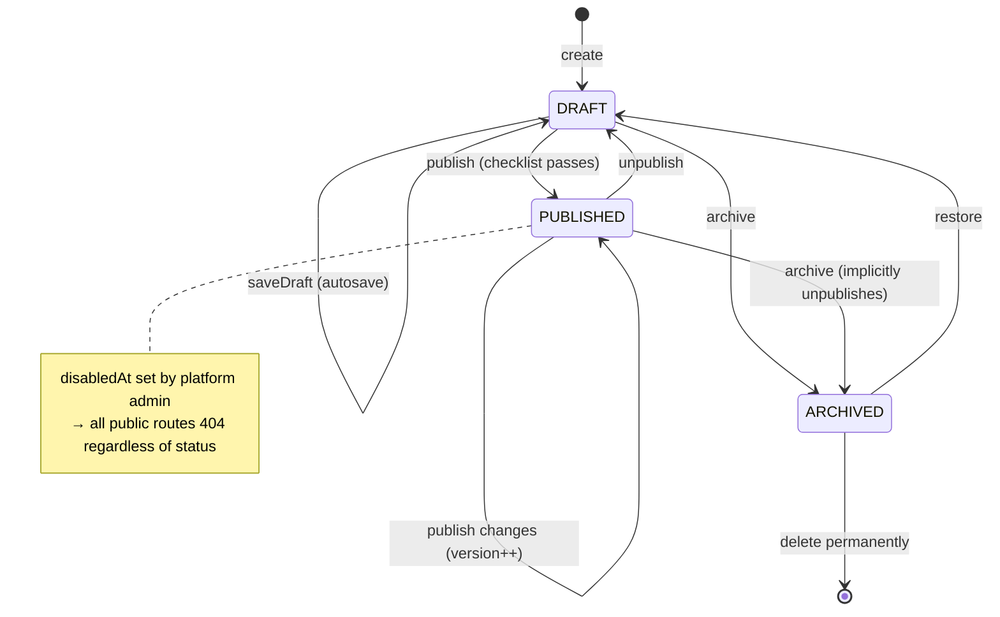
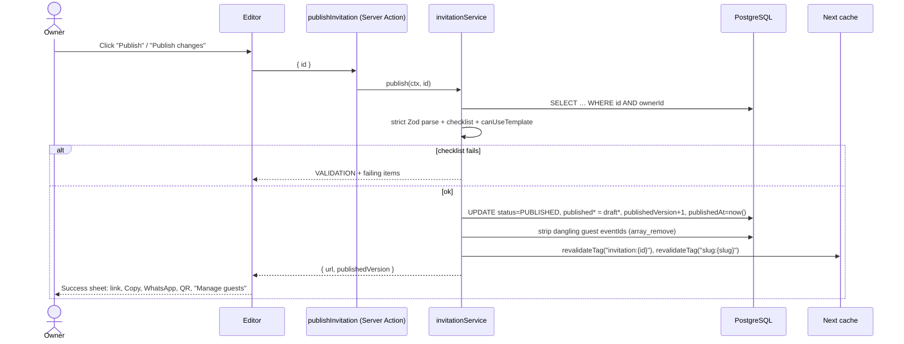
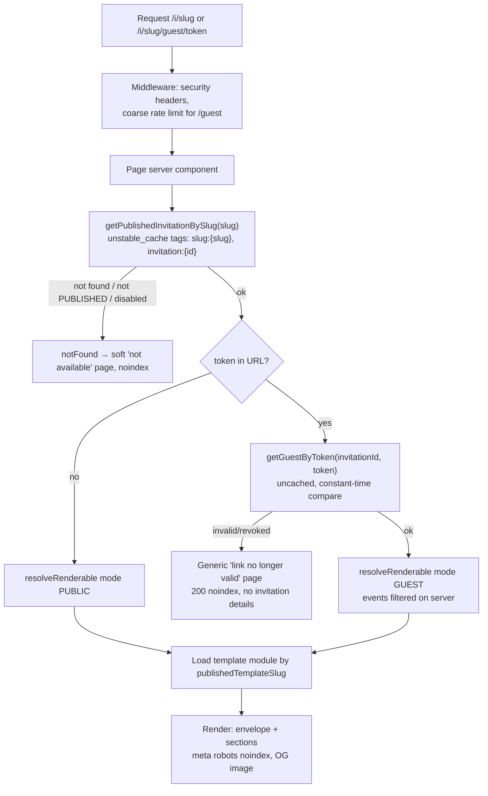

# 06 — Invitation Publishing Workflow

## 1. Principles

- **No per-invitation deployments.** One Next.js app renders every invitation dynamically from the DB.
- **Drafts are never public.** Public routes read only `published*` columns of rows with `status = PUBLISHED` and `disabledAt IS NULL`.
- **Publishing is a snapshot.** Editing after publish never changes what guests see until "Publish changes".
- **Cache by invitation, purge on change.** Published pages are cached and invalidated with `revalidateTag("invitation:{id}")`.

## 2. State machine

After **unpublish**, the published snapshot columns are kept (so re-publishing is instant), but public routes stop serving them because `status ≠ PUBLISHED`.

## 3. Publish checklist (strict validation)

Run by `getPublishChecklist(id)` and again inside `publishInvitation` (server is authoritative).

| Key | Rule | Severity |
|---|---|---|
| `names` | Bride and groom first names present | required |
| `date` | `weddingDate` valid | required |
| `events` | ≥ 1 event; each has name, date, start time, venue name | required |
| `mapsUrls` | Every `mapsUrl` (if set) is an allowed Google Maps URL | required |
| `slug` | Valid, unique, not reserved | required |
| `template` | Template active and `canUseTemplate(user, slug)` | required |
| `strictSchema` | `InvitationContentSchema.parse(draftContent)` succeeds | required |
| `welcome` | Welcome message not still the demo text | recommended |
| `photos` | At least one couple photo if `hero`/`couple` section uses it | recommended |
| `sampleData` | No remaining demo media/events (flagged with `isSample`) | recommended |
| `music` | Music chosen if template's music toggle is on | recommended |

## 4. Publish sequence

## 5. Public request flow (`/i/[slug]` and `/i/[slug]/guest/[token]`)

Implementation notes:

- `getPublishedInvitationBySlug` selects only `id, slug, status, disabledAt, publishedTemplateSlug, publishedContent, publishedDesign, publishedVersion` — never owner data.
- Template is chosen from **`publishedTemplateSlug`** (not `templateSlug`) so switching template in the draft doesn't affect the live page.
- `generateMetadata` uses the same cached fetch: title `"Priya & Rahul — 14 Feb 2027"`, description from welcome message (truncated), OG image `/api/og/{slug}?v={publishedVersion}`.
- Guest routes set `export const dynamic = "force-dynamic"` and response header `Cache-Control: private, no-store`; the published snapshot itself still comes from the tagged data cache.
- Public route `/i/[slug]` is ISR: `export const revalidate = false` + tag invalidation. On a cold cache, it renders on demand and caches.

## 6. Preview vs public vs demo

| Surface | Route | Data | Who | Indexing |
|---|---|---|---|---|
| Editor live preview | `/preview/{invitationId}` (iframe) | Draft (lenient parse) + postMessage updates | Owner only (session + ownership) | noindex, `X-Frame-Options: SAMEORIGIN` |
| Shareable draft preview | *Not in MVP* (future: signed expiring preview token) | — | — | — |
| Public invite | `/i/{slug}` | Published snapshot | Anyone with link | noindex by default (owner toggle "Allow search engines" — future) |
| Guest invite | `/i/{slug}/guest/{token}` | Published snapshot + guest | Token holder | noindex, no-store |
| Template demo | `/templates/{slug}/preview` | Template `demo.ts` | Anyone | indexable (marketing) |

## 7. Sharing after publish

- **Copy link** — `navigator.clipboard.writeText` with fallback.
- **WhatsApp** — `https://wa.me/?text=` + URL-encoded message:
  `"Priya & Rahul are getting married! 💍 Open your invitation: https://vivah.studio/i/rahul-priya"`.
  For guests with a phone, `https://wa.me/91XXXXXXXXXX?text=…`. Clicking marks guest `SHARED`.
- **QR code** — generated client-side (`qrcode`), downloadable PNG with the couple's names under it.
- **OG preview** — WhatsApp shows the OG image (template-styled, names + date). Guest routes use the
  same invitation-level OG image (no guest names in OG — previews can be forwarded).

## 8. Failure & edge cases

| Case | Behaviour |
|---|---|
| Publish while another tab edits | Publish copies the latest committed draft; other tab gets `CONFLICT` on next save and reloads |
| Template deactivated after publish | Live invite keeps working (template code still deployed); editor shows "This design is retired" and blocks new publishes only if `canUseTemplate` fails |
| Template code removed in a deploy | Not allowed: retired templates stay in the registry with `isActive=false` |
| Slug changed after publish | Old slug 404s immediately; UI warns before saving; tags for both slugs revalidated |
| DB down | Cached published pages keep serving; uncached/guest pages show a friendly retry page (500 boundary) |
| Content schema bump (v1 → v2) | `migrateContent` runs on read in `resolveRenderable`; published snapshots are migrated lazily on read and rewritten on next publish |
