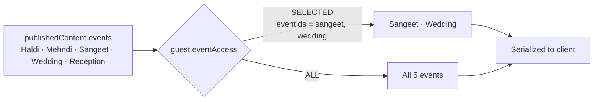

# 07 — Guest-Specific Links & Privacy Architecture

## 1. Goals

1. Each guest gets a personal, unguessable link that shows their name and only their events.
2. A guest can never discover other guests, other tokens, the owner's private notes, or events they aren't invited to.
3. URLs contain no PII and no sequential/internal ids.
4. Owners can revoke and reissue links at any time.

## 2. URL format

```
https://invitationbanao.com/i/{invitationSlug}/guest/{token}

https://invitationbanao.com/i/rahul-priya/guest/q7Jx2mV9kP0aLr4tWc8NbE
https://invitationbanao.com/i/rahul-priya/guest/Zt3pH6yQs1Fd9uBn0Ke5Rw
```

- `invitationSlug` — human-friendly, chosen by owner (e.g. `rahul-priya`). Not secret.
- `token` — **22 chars base64url = 128 bits** from `crypto.randomBytes(16)`. This is the capability.
- No guest name, id, phone or index in the URL. Display name only appears in the page body.

## 3. Token generation

```ts
// src/server/services/guest-tokens.ts
import "server-only";
import { randomBytes } from "node:crypto";

export function generateGuestToken(): string {
  return randomBytes(16).toString("base64url"); // 22 chars, 128-bit entropy
}

export async function createUniqueToken(tx: Prisma.TransactionClient) {
  for (let i = 0; i < 3; i++) {
    const token = generateGuestToken();
    const clash = await tx.guest.findUnique({ where: { token }, select: { id: true } });
    if (!clash) return token;     // collision probability ~0; loop is belt-and-braces
  }
  throw new Error("TOKEN_GENERATION_FAILED");
}
```

Why stored in plaintext (not hashed): the owner must be able to copy the link again at any time.
The token is a link capability for a low-sensitivity page (similar to an unlisted video link), not
an account credential. Mitigations: 128-bit entropy, rate limiting, revocation, `noindex`, no-store,
and the page reveals nothing beyond what the owner chose to share with that guest.
(If requirements change, switch to storing `sha256(token)` and showing links only at creation — the URL format stays the same.)

## 4. Lookup & rendering (server only)

```ts
// src/server/services/public-invitations.ts (excerpt)
export async function getGuestView(slug: string, token: string) {
  if (!/^[A-Za-z0-9_-]{22}$/.test(token)) return { kind: "INVALID" } as const;   // cheap reject
  const inv = await getPublishedInvitationBySlug(slug);                            // cached
  if (!inv) return { kind: "NOT_FOUND" } as const;

  const guest = await prisma.guest.findFirst({
    where: { token, invitationId: inv.id },                    // token must belong to THIS invitation
    select: { id: true, displayName: true, greeting: true, personalNote: true, eventAccess: true, eventIds: true },
  });
  if (!guest) return { kind: "INVALID" } as const;           // includes revoked tokens & other invitations' tokens

  return {
    kind: "OK",
    data: resolveRenderable({ mode: "GUEST", templateSlug: inv.publishedTemplateSlug, content: inv.publishedContent, design: inv.publishedDesign, guest }),
    guestId: guest.id,                                        // server-side only, used for beacon signing
  } as const;
}
```

What reaches the browser (`RenderableInvitation.guest`):

```json
{ "displayName": "Sharma Family", "greeting": "Dear Sharma ji and family", "personalNote": "Your blessings mean the world to us." }
```

Never serialized: `id`, `token` (other than in the URL already held), `notes`, `phone`, `eventIds`,
`eventAccess`, `status`, open counts, other guests, owner email/name, draft content.

## 5. Event filtering



- Filtering is in `resolveRenderable` on the server; filtered-out events never leave the server.
- Countdown targets the guest's **first visible event** (so a Reception-only guest counts down to the Reception).
- `.ics` endpoint for a restricted event requires `?t={token}` and re-checks access.
- If `SELECTED` resolves to zero events (all deleted), show the general invitation without the events section and log a warning for the owner's checklist.

## 6. Open tracking ("View guest invitation status")

```mermaid
sequenceDiagram
    participant G as Guest browser
    participant B as /api/v1/beacon/open
    participant DB as PostgreSQL
    G->>G: Taps "Open Invitation"
    G->>B: navigator.sendBeacon({ slug, token }) — once per session
    B->>B: rate limit by IP; validate shapes
    B->>DB: UPDATE guest SET openCount+1, lastOpenedAt=now(),<br/>firstOpenedAt=COALESCE(firstOpenedAt, now()), status='OPENED'<br/>WHERE token=$1 AND invitation.slug=$2 AND invitation published
    B->>DB: UPDATE invitation SET openCount+1
    B-->>G: 204 (always, even if nothing matched)
```

- Counting is on the **Open** tap, not page load, so WhatsApp's link-preview crawler doesn't mark guests as opened.
- Bots filtered by `user-agent` (WhatsApp, facebookexternalhit, Twitterbot, Slackbot, TelegramBot) as a second guard.
- Public (non-guest) opens increment only the invitation counter.
- No IP addresses, device fingerprints or analytics cookies are stored for guests in the MVP.

## 7. Revocation

- **Regenerate link**: old token moved to `RevokedGuestToken`, new token issued. Old link → generic
  "This invitation link has been updated. Please ask the host for the new link." (same page for unknown tokens — no oracle distinguishing "revoked" vs "never existed").
- **Delete guest**: guest row and revoked tokens deleted; link becomes invalid.
- **Unpublish / archive / disable invitation**: all guest links stop working immediately (status check + cache purge).

## 8. Threats & mitigations

| Threat | Mitigation |
|---|---|
| Token guessing / enumeration | 128-bit tokens; per-IP rate limits on `/i/*/guest/*` (120/min) and invalid-token counter (10/10 min → short-circuit); constant response for invalid tokens |
| Token from invitation A used on invitation B's slug | Lookup requires `token` **and** `invitationId` match |
| Link forwarded to someone else | Accepted risk (same as a paper card). Owner can regenerate. Page reveals only what that guest was meant to see. |
| Search engines indexing personal pages | `<meta name="robots" content="noindex,nofollow">`, `X-Robots-Tag: noindex`, `robots.txt` disallows `/i/` |
| Referrer leakage of token to third parties (maps, YouTube, Cloudinary) | `Referrer-Policy: no-referrer` on `/i/**`; external links `rel="noopener noreferrer"` |
| Token in analytics/logs | Vercel Analytics configured to strip `/guest/*` path segments (`beforeSend` rewrite to `/i/[slug]/guest/[token]`); Sentry `beforeSend` scrubs tokens from URLs |
| Cached personalized page served to another user | `Cache-Control: private, no-store` on guest routes; no CDN caching of guest HTML |
| XSS via guest name/greeting | All text rendered as React text nodes; no `dangerouslySetInnerHTML`; CSP |
| Owner A reading Owner B's guests | All guest service functions filter by `invitation.ownerId = ctx.userId`; covered by authz tests |
| Leakage via OG image | OG images are invitation-level only; no guest names |

## 9. Tests that must exist (Phase 5)

1. Guest page HTML/RSC payload for a `SELECTED` guest does **not** contain names of non-invited events (string search on full response).
2. Payload contains no other guest's display name or any token other than the URL's.
3. Payload contains no `notes`, `phone`, owner email.
4. Token of invitation A on slug B → invalid page.
5. Revoked token → invalid page, identical HTML to an unknown token.
6. Unpublished invitation → all guest links 404/invalid.
7. Beacon with garbage input → 204 and no DB change.
8. Owner B's session cannot list/update/delete Owner A's guests (actions return `NOT_FOUND`).
