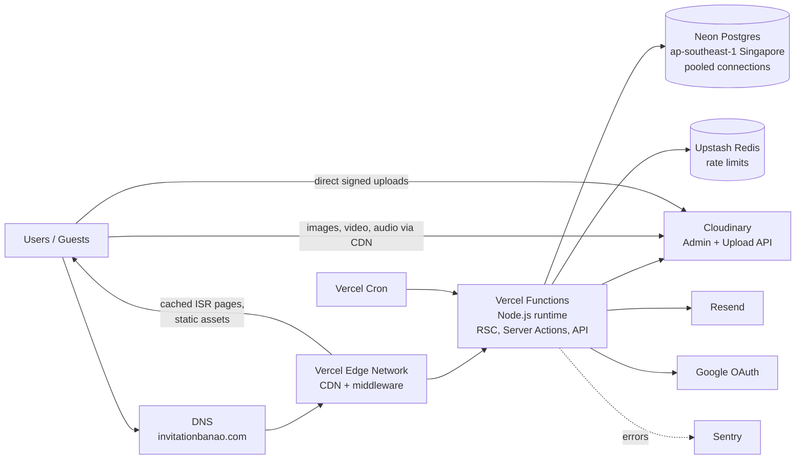

# 14 — Deployment Architecture

## 1. Topology



- **Region**: Vercel functions in `sin1` (Singapore) or `bom1` (Mumbai) colocated with Neon (`ap-southeast-1`) to minimize DB latency for Indian users.
- **Runtime**: Node.js for all server code (Prisma, Cloudinary SDK, crypto). Middleware runs on the edge and must not import Prisma.
- **Static/ISR**: marketing pages and published invitations are served from Vercel's CDN cache; only guest pages, dashboard and actions hit functions.

## 2. Environments

| Env | Branch | Database | Cloudinary | Domain |
|---|---|---|---|---|
| Local | any | Docker Postgres 16 or personal Neon branch | dev folder `vivah-dev/` | `localhost:3000` |
| Preview | PRs | Neon **branch per PR** (Vercel–Neon integration) | `vivah-preview/` | `*.vercel.app` (auth via Google test client) |
| Production | `main` | Neon main branch | `vivah/` | `invitationbanao.com` |

## 3. CI/CD pipeline

```mermaid
flowchart LR
    PR[Pull request] --> CI[GitHub Actions:<br/>install · lint · typecheck · unit · template contract tests]
    CI --> PV[Vercel preview deploy<br/>+ Neon branch + prisma migrate deploy]
    PV --> E2E[Playwright e2e against preview URL]
    E2E --> REV[Review + merge]
    REV --> PROD[Vercel production build]
    PROD --> MIG[prisma migrate deploy<br/>(build step, unpooled URL)]
    MIG --> SEED[seed templates (idempotent upsert)]
    SEED --> LIVE[Promote]
```

- Build command: `prisma generate && prisma migrate deploy && pnpm db:seed:templates && next build`.
- Migrations must be **backward compatible** (expand → migrate → contract) because the old deployment serves traffic until promotion.
- Rollback: Vercel instant rollback for code; DB rollbacks via forward-fix migration (Neon PITR as last resort).

## 4. Caching & invalidation

| Content | Mechanism | Invalidation |
|---|---|---|
| Marketing pages | SSG | Redeploy, or `revalidateTag("templates")` when catalogue rows change |
| Published invitation `/i/[slug]` | ISR + `unstable_cache` tags `invitation:{id}`, `slug:{slug}` | On publish / unpublish / archive / disable / slug change |
| OG images | CDN cache with `?v={publishedVersion}` cache-buster | Version bump on publish |
| Guest pages | Dynamic, `no-store` HTML; underlying snapshot from data cache | Same tags as above |
| Media | Cloudinary CDN, immutable versioned URLs | New upload = new URL |

## 5. Scheduled jobs (Vercel Cron)

| Job | Schedule | Action |
|---|---|---|
| `/api/cron/media-cleanup` | daily 03:00 IST | Delete Cloudinary assets with `deletedAt` > 24 h or orphaned (no invitation) > 7 days |
| `/api/cron/purge-deleted` | daily 03:30 IST | Hard delete users/invitations soft-deleted > 30 days |

Both require `Authorization: Bearer ${CRON_SECRET}`.

## 6. Observability

- Sentry (server + client + edge), release tagging by commit SHA, source maps uploaded.
- Vercel Analytics + Speed Insights (Core Web Vitals per route; guest token paths normalized).
- Uptime check on `/api/health` and one published demo invitation (Better Stack / UptimeRobot).
- Neon dashboards for query latency; Prisma query logging in preview only.

## 7. Cost estimate at MVP scale (≈ 500 invitations, 50k guest opens/month)

| Service | Plan | Approx. monthly |
|---|---|---|
| Vercel | Pro (1 seat) | $20 |
| Neon | Launch | $19 |
| Cloudinary | Plus (225 credits) — free tier OK for beta | $0–$99 |
| Upstash Redis | Pay-as-you-go | < $5 |
| Resend | Free (3k emails) | $0 |
| Sentry | Developer/Team | $0–$26 |
| **Total** | | **≈ $45–$170** |

Biggest variable: Cloudinary bandwidth (video + galleries). Mitigate with aggressive `q_auto`,
capped widths, video posters + lazy load, and moving to S3 + CloudFront if bandwidth dominates
(the `MediaStorage` interface makes this a contained change).

## 8. Launch checklist

Step-by-step instructions for each item: [18-launch-runbook.md](18-launch-runbook.md).

- [ ] Domain + HTTPS + HSTS preload
- [ ] Production Google OAuth consent screen verified
- [ ] Resend domain (SPF, DKIM, DMARC) verified
- [ ] Neon backups/PITR verified with a restore drill
- [ ] Sentry alerts routed
- [ ] CSP enforced (after a week in report-only on preview)
- [ ] Legal pages live (Terms, Privacy)
- [ ] All 5 templates pass acceptance in doc 10 §7
