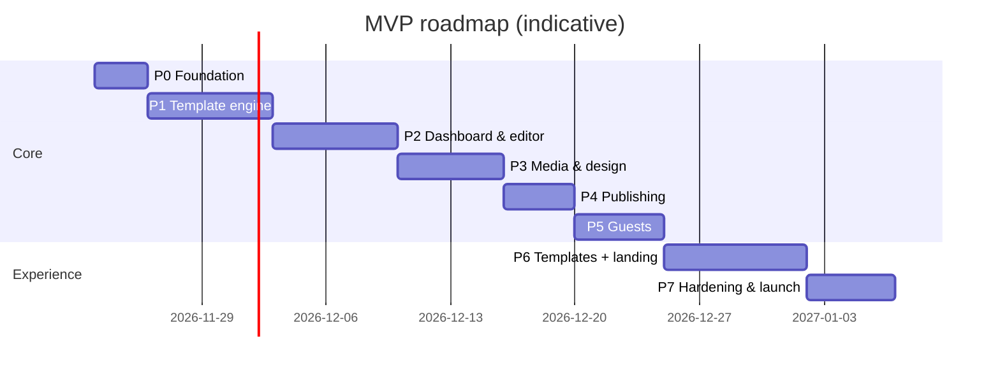

# 15 — Development Phases & Milestones

Build in small, working increments. Each phase ends with something you can click through.
**Claude Code: implement one phase per session, stop at its acceptance criteria, and summarize.**

| Phase | Name | Outcome | Est. (1 dev + Claude Code) |
|---|---|---|---|
| 0 | Foundation | App boots, DB + auth work, shells exist | 2–3 days |
| 1 | Template engine + 2 templates | Demo invites render with envelope animation | 5–7 days |
| 2 | Dashboard & editor core | Create/list/edit invitations with live preview | 5–7 days |
| 3 | Media & design customization | Uploads, gallery, music, video, palettes, sections | 4–6 days |
| 4 | Publishing & sharing | Public `/i/[slug]`, publish snapshots, OG, QR | 3–4 days |
| 5 | Guests & personalized links | Guest manager, tokens, filtered events, open status | 3–5 days |
| 6 | Remaining templates + landing page | 5 templates, premium marketing site | 6–8 days |
| 7 | Hardening & launch | Security, perf, a11y, tests, deploy | 3–5 days |

---

## Phase 0 — Foundation

**Read before starting:** CLAUDE.md, 02-architecture, 03-database, 12-folder-structure, 13-security §1–2, 11-design-system §2.

**Tasks**
1. Scaffold Next.js 15 (App Router, TS strict, `src/`, pnpm), Tailwind v4, ESLint (+ boundary rules from doc 12), Prettier, Vitest, Playwright.
2. Add studio tokens and fonts (Inter, Fraunces) to `globals.css`/root layout; install shadcn/ui (button, input, dialog, sheet, dropdown-menu, tabs, toast/sonner, switch, select, tooltip, skeleton).
3. Prisma schema exactly as doc 03 §3 (MVP models only); Neon/Docker connection; first migration; `prisma/seed.ts` stub.
4. Auth.js v5: Google + Resend magic link, Prisma adapter, `/login` page, `requireUser()`, middleware gate for `/dashboard` and `/preview`.
5. Route group shells: `(marketing)` placeholder home, `(dashboard)` layout with sidebar/topbar, empty overview.
6. `src/lib/action-result.ts`, `AppError`, `src/server/db/prisma.ts`, `src/server/authz/*`.
7. `.env.example`, README dev setup, security headers in `next.config.ts`.

**Acceptance**
- [ ] `pnpm dev` runs; `pnpm lint typecheck test` pass
- [ ] Sign in with Google and email link works locally; signed-out access to `/dashboard` redirects to `/login?callbackUrl=…`
- [ ] Prisma migration applies cleanly on a fresh DB
- [ ] Dashboard shell responsive at 375 and 1440

---

## Phase 1 — Template engine + first 2 templates

**Read before starting:** 05-template-engine (all), 10-template-specs §0, §1, §2, §6, 11-design-system §3–4.

**Tasks**
1. `src/lib/invitation/schema.ts` (Zod content + design), `manifest.ts` (types + `optionsToZod`), `resolve.ts`, `defaults.ts` + unit tests.
2. Invitation kit: `InvitationRenderer`, `ThemeProvider` (CSS vars), `SectionBoundary`, `Reveal/Stagger`, `useCountdown`, `MusicController` + `MusicToggle`, `CloudImage` (works with plain URLs too for now), `MapLink`, `AddToCalendar` (client-side .ics blob for now), `Particles`, reduced-motion handling, skip-intro.
3. `_starter` template skeleton.
4. **Royal Heritage** and **Minimal Luxury** templates — full envelope + opening + all sections, demo data with placeholder images in `/public/templates/<slug>/demo/`.
5. Registry + `/templates/[slug]/preview` route rendering demo data (no DB needed).
6. Template contract test (renders each template: demo, guest, reduced motion, all options).

**Acceptance**
- [ ] `/templates/royal-heritage/preview` and `/templates/minimal-luxury/preview` show envelope → tap → opening → full invitation with music toggle, countdown, events, gallery lightbox
- [ ] Opening runs smoothly with 4× CPU throttle (no long tasks > 50 ms during sequence)
- [ ] Reduced motion → crossfade only
- [ ] `?palette=` and `?font=` query params switch theme without reload of template code
- [ ] Adding a template requires only folder + registry lines (verified by `_starter` copy test)

---

## Phase 2 — Dashboard & editor core

**Read before starting:** 01-prd §6.3–6.4, 04-api-design §1–2.2, 06-publishing-workflow §6, 08-dashboard-specs §0–5.2, 13-security §2.

**Tasks**
1. Services: `invitations.ts` (create, list, getForEditor, saveDraft w/ optimistic lock, updateMeta, checkSlug, changeSlug, duplicate, archive/restore, delete) + authz tests.
2. Seed templates into DB from registry (`pnpm db:seed`).
3. Create flow (design → couple; link auto-generated), slug suggestions + availability in the publish dialog.
4. Invitations list (grid/table, tabs, search, kebab actions, confirmations) and Overview page with stats.
5. Editor shell: tabs, save-state indicator, autosave (debounced 1 s), conflict handling, mobile bottom bar.
6. Details tab and Events tab (dnd-kit reorder, presets, maps URL validation).
7. Preview iframe `/preview/[id]` + typed postMessage bridge (`draft:update`, `preview:scrollTo`, `preview:replayIntro`), device toggle.
8. Switch template (modal) and Settings tab.

**Acceptance**
- [ ] Create → edit names/events → preview updates instantly (< 100 ms) without network round-trip
- [ ] Reload shows autosaved data; two tabs editing → second gets conflict message
- [ ] Duplicate/archive/restore/delete work with confirmations
- [ ] Owner B cannot open owner A's editor or preview (404) — e2e test
- [ ] Editor usable at 375px

---

## Phase 3 — Media & design customization

**Read before starting:** 04-api-design §2.4, 08-dashboard-specs §5.3–5.4, 13-security §5, 11-design-system §5.

**Tasks**
1. `MediaStorage` interface + Cloudinary implementation; `/api/v1/media/sign`; `confirmMediaUpload`; quota checks; media service + tests.
2. Media tab: dropzones, progress, reorder, alt text, focal point, delete with undo; couple/family/gallery/video/music; music library (bundled tracks).
3. `CloudImage` with Cloudinary loader + blur placeholders; video player with poster; YouTube nocookie embed.
4. Design tab: palettes (+ custom colors with contrast warning), font pairs, backgrounds (preset/upload), sections sortable + visibility, animation settings, manifest-generated template options, reset to defaults.

**Acceptance**
- [ ] Upload 20 photos on mobile network; progress shown; failures retryable
- [ ] Images in preview are responsive Cloudinary URLs (`f_auto,q_auto,w_*`)
- [ ] Hiding/reordering sections and changing palette/fonts reflect instantly in preview
- [ ] Unsupported file types/sizes rejected client- and server-side
- [ ] Deleting a media item removes it from content references

---

## Phase 4 — Publishing & sharing

**Read before starting:** 06-publishing-workflow (all), 04-api-design §2.5, 07-guest-links §8 (indexing/referrer rows), 14-deployment §4.

**Tasks**
1. `publishing.ts`: checklist, publish (snapshot copy, version++), unpublish, cache tags revalidation.
2. `/i/[slug]` public page using `publishedTemplateSlug` + published snapshot; not-found page; metadata; `noindex`; `Referrer-Policy: no-referrer`.
3. `/api/og/[slug]` OG image per template style; `/api/v1/ics/[slug]/[eventId]`.
4. Share page/sheet: checklist with fix links, copy, WhatsApp, QR download, publish changes / unpublish.
5. Open beacon for public opens (invitation counter).

**Acceptance**
- [ ] Draft content never visible at `/i/[slug]` (e2e: edit after publish → public unchanged until "Publish changes")
- [ ] Unpublish/archive → 404 within seconds
- [ ] WhatsApp link preview shows OG image (test via opengraph debugger on preview deploy)
- [ ] `.ics` imports into Google Calendar and Apple Calendar with correct timezone

---

## Phase 5 — Guests & personalized links

**Read before starting:** 07-guest-links-and-privacy (all), 08-dashboard-specs §6, 04-api-design §2.3, 03-database §3 Guest.

**Tasks**
1. Guest service: add, bulk add, update, delete, regenerate token (with `RevokedGuestToken`), markShared, list, CSV export; authz tests.
2. Guest manager UI (table + mobile cards, sheets, bulk dialog, status pills, WhatsApp share with personalized message).
3. `/i/[slug]/guest/[token]` route with `getGuestView`; personalized greeting in envelope + greeting section; server-side event filtering; countdown to first visible event; `no-store`.
4. Beacon handles guest tokens (status → OPENED, counts), bot filtering.
5. Rate limiting for guest routes and invalid tokens (Upstash).
6. Privacy test suite from doc 07 §9.

**Acceptance**
- [ ] Seeded "Sharma Family" (SELECTED: Sangeet + Wedding) sees only those events; response payload contains no other event names
- [ ] Regenerated link: old link shows generic invalid page; new link works
- [ ] Status changes Not shared → Shared (on copy/WhatsApp) → Opened (on Open tap, not on WhatsApp preview fetch)
- [ ] All doc 07 §9 tests pass

---

## Phase 6 — Remaining templates + premium landing page

> **Status (2026-11-21):** tasks 2–5 done (landing, catalogue, detail, about/contact/legal, contact API, SEO,
> posters + loops for live templates). Task 1 (three new templates) deferred by the product owner.

**Read before starting:** 10-template-specs §3–5, 09-landing-page-specs (all), 11-design-system (all), 05-template-engine §11.

**Tasks**
1. **Floral Romance**, **Cinematic Elegance**, **Modern Editorial** templates (each via `_starter`).
2. Template posters + short envelope loop videos (record from preview routes with Playwright; compress to WebM/MP4 ≤ 600 KB).
3. Home page sections 3.1–3.11, catalogue, template detail with live iframe preview, about/contact, legal pages, footer badge link.
4. Contact API with Resend + honeypot + rate limit.
5. SEO: metadata, sitemap, robots, JSON-LD.

**Acceptance**
- [ ] All 5 templates pass doc 10 §7 checklist
- [ ] Landing Lighthouse mobile: perf ≥ 90, a11y ≥ 95, SEO ≥ 95
- [ ] "Use this design" signed-out → login → create flow with template preselected
- [ ] Visual review sign-off by product owner

---

## Phase 7 — Hardening & launch

> **Status (2026-11-21):** code tasks done — CSP (nonce on dynamic routes) with zero violations,
> Sentry (scrubbed, lazy), audit logs, security tests, full-journey e2e, hand-written a11y audit, guest
> pages 191 → 145 KB, crons + health, CI, `/admin` stats. Deploy, restore drill and monitors need the owner's
> accounts: see [18-launch-runbook.md](18-launch-runbook.md).

**Read before starting:** 13-security (all), 14-deployment (all), 01-prd §7.

**Tasks**
1. CSP (report-only → enforce), header audit, Sentry with scrubbing, Vercel Analytics path normalization.
2. Security checklist doc 13 §11; e2e for the full journey (create → publish → guests → guest open).
3. Performance pass: bundle analysis per template, image sizes, font subsetting, `LazyMotion` strict.
4. Accessibility audit (axe in Playwright) for landing, dashboard, all templates.
5. Cron jobs (media cleanup, purge), health endpoint, uptime monitor.
6. Production deploy per doc 14 launch checklist; optional read-only `/admin` stats page (ADMIN role).

**Acceptance**
- [ ] All NFRs in doc 01 §7 measured and met (or deviations logged in doc 16)
- [ ] No high/critical `pnpm audit` issues; CSP enforced with zero violations on all templates
- [ ] Restore drill done; launch checklist complete

---

## Post-MVP backlog (not to be built now)

Payments (doc 17) · RSVP · editable WhatsApp message · custom domains · shareable draft preview links ·
co-editor invites · more templates (regional: South Indian, Punjabi, Nikah, Bengali) · engagement/other
event types · multi-language UI · slug redirects · template marketplace.
