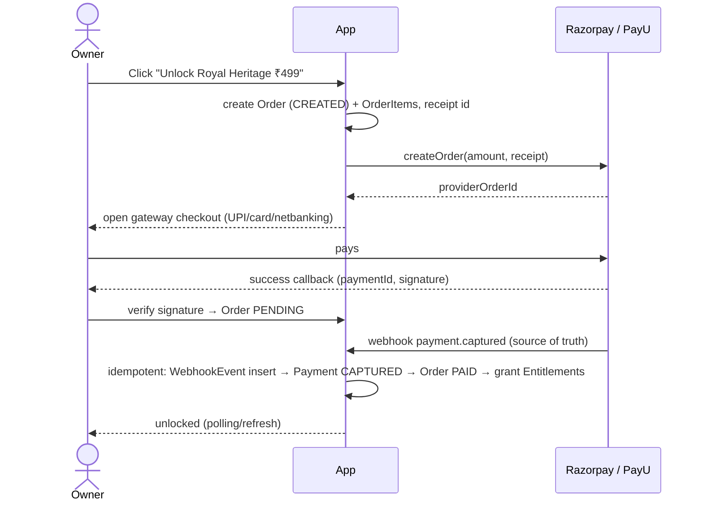

# 17 — Future Payments (Razorpay / PayU) — Design Only

> **Not part of the MVP.** Do not install gateway SDKs, create checkout UI, or add Order/Payment
> tables until a payments phase is approved. The MVP only ships the `Entitlement` table and
> `canUseTemplate()` / `canUseFeature()` seams described here.

## 1. Monetization models to support

| Model | Example | What is purchased |
|---|---|---|
| Premium template purchase | "Royal Heritage — ₹499" | `TEMPLATE` entitlement for a user (usable on any of their invitations) |
| Paid invitation creation/publish | "Publish an invitation — ₹299" | `INVITATION_PUBLISH` entitlement bound to one invitation |
| Premium customization | Remove badge, video section, custom music, extra gallery | `FEATURE` entitlement (per invitation or per user) |
| Bundles / offers | Template + all features | Multiple entitlements from one order |

## 2. MVP seam (implemented now)

```ts
// src/server/services/entitlements.ts
export async function canUseTemplate(userId: string, templateSlug: string): Promise<boolean> {
  const t = await getTemplate(templateSlug);
  if (!t?.isActive) return false;
  if (t.tier === "FREE" || env.LAUNCH_ALL_FREE) return true;
  return hasEntitlement(userId, { type: "TEMPLATE", templateSlug });
}

export async function canUseFeature(userId: string, invitationId: string, feature: Feature): Promise<boolean> {
  if (env.LAUNCH_ALL_FREE) return true;
  return hasEntitlement(userId, { type: "FEATURE", feature, invitationId });
}

export async function canPublish(userId: string, invitationId: string): Promise<boolean> {
  if (env.LAUNCH_ALL_FREE) return true;
  return hasEntitlement(userId, { type: "INVITATION_PUBLISH", invitationId });
}
```

All gating in the app (create flow, publish, design options marked `premium: true` in manifests)
calls these functions. Turning on payments = flipping `LAUNCH_ALL_FREE` and adding checkout.

## 3. Future schema (to be added in the payments phase)

```prisma
model Product {
  id          String      @id @default(cuid())
  sku         String      @unique            // "TEMPLATE:royal-heritage", "PUBLISH", "FEATURE:REMOVE_BADGE"
  kind        ProductKind
  name        String
  pricePaise  Int
  currency    String      @default("INR")
  isActive    Boolean     @default(true)
  grants      Json                            // [{type:"TEMPLATE", templateSlug:"royal-heritage"}]
}

model Order {
  id              String        @id @default(cuid())
  userId          String
  invitationId    String?
  status          OrderStatus   @default(CREATED)  // CREATED → PENDING → PAID | FAILED | CANCELLED | REFUNDED
  amountPaise     Int
  currency        String        @default("INR")
  provider        PaymentProvider?                 // RAZORPAY | PAYU
  providerOrderId String?       @unique
  couponCode      String?
  receipt         String        @unique            // our idempotency/receipt id
  createdAt       DateTime      @default(now())
  updatedAt       DateTime      @updatedAt
  items           OrderItem[]
  payments        Payment[]
}

model OrderItem {
  id          String  @id @default(cuid())
  orderId     String
  productId   String
  sku         String
  amountPaise Int
  quantity    Int     @default(1)
}

model Payment {
  id                String        @id @default(cuid())
  orderId           String
  provider          PaymentProvider
  providerPaymentId String        @unique
  status            PaymentStatus                  // AUTHORIZED | CAPTURED | FAILED | REFUNDED
  amountPaise       Int
  method            String?                        // upi, card, netbanking
  raw               Json                           // gateway payload (no card data)
  createdAt         DateTime      @default(now())
}

model WebhookEvent {
  id          String   @id                       // provider event id → idempotency
  provider    PaymentProvider
  type        String
  payload     Json
  processedAt DateTime?
  createdAt   DateTime @default(now())
}
```

`Entitlement.orderId` then becomes a real FK.

## 4. Gateway abstraction

```ts
// src/server/integrations/payments/PaymentGateway.ts
export interface PaymentGateway {
  provider: "RAZORPAY" | "PAYU";
  createOrder(input: { receipt: string; amountPaise: number; currency: "INR"; notes: Record<string,string> }):
    Promise<{ providerOrderId: string; checkout: CheckoutParams }>;
  verifyPaymentSignature(payload: unknown): boolean;            // client callback verification
  verifyWebhook(rawBody: string, headers: Headers): boolean;    // HMAC check
  parseWebhook(rawBody: string): NormalizedPaymentEvent;
  refund(providerPaymentId: string, amountPaise?: number): Promise<void>;
}
```

Implementations: `razorpay.ts` (Orders API + Checkout.js + `X-Razorpay-Signature` webhooks),
`payu.ts` (hash-based form post + reverse hash verification + webhook). Choose provider by config.

## 5. Future checkout flow



Rules for later: webhook is the source of truth; entitlements granted only on `PAID`; all amounts
in paise; GST invoice generation; no card data stored (gateway-hosted checkout only).

## 6. What MVP code must avoid (to stay payment-ready)

- Hard-coding "free" checks in UI — always call the entitlement functions.
- Embedding prices in template manifests — prices live in DB (`Template.pricePaise` now, `Product` later).
- Coupling publish logic to "always allowed" — publish calls `canPublish()`.
